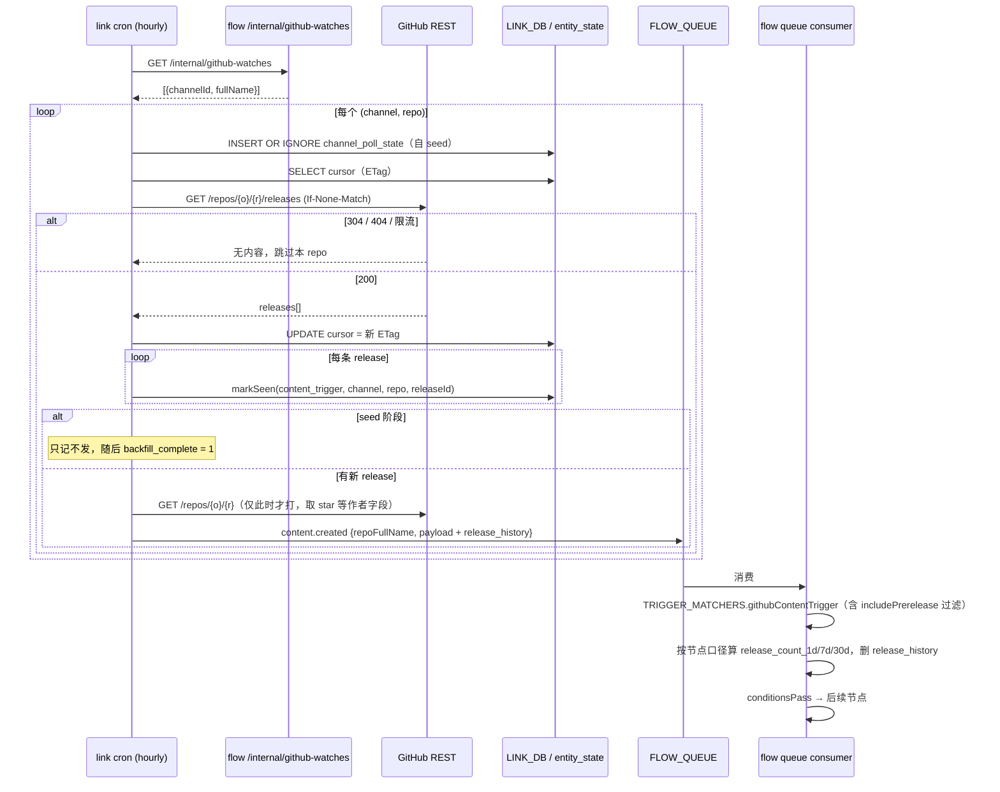

# GitHub Release Content Channel Implementation Plan

> **For agentic workers:** REQUIRED SUB-SKILL: Use superpowers:subagent-driven-development (recommended) or superpowers:executing-plans to implement this plan task-by-task. Steps use checkbox (`- [ ]`) syntax for tracking.

**Goal:** 租户连接 GitHub 账号后，从自己 Watch 的 repo 中选若干个，这些 repo 的 release 触发 content flow，release 正文进 `content_text`，并可按「1/7/30 天内发版数」设条件。

**Architecture:** 新增 `GITHUB` channel（OAuth，每租户一行，无 per-repo channel 行）；`link` 每小时轮询 `graph_json` 里被 `githubContentTrigger` 点名的 repo 的 `/releases`，去重后发 `content.created` 队列消息；`flow` 侧 trigger 匹配时按节点的 `includePrerelease` 从 payload 携带的 `release_history` 算出三个计数再求值条件。

**Tech Stack:** Cloudflare Workers（Hono）、D1、Cloudflare Queues、React + ReactFlow 前端、Vitest。

设计依据：`docs/superpowers/specs/2026-08-10-github-release-content-channel-design.md`（D1–D7）。

## Global Constraints

- **`flowType: "trigger"`** — release **永不**写入 D1 `content` 表，只走 `recordTriggerContentSeen` + `emitContentTriggerEvent`，绝不调用 `upsertContentFromMetadata`（后者对非 `"content"` 的 flowType 会抛错）。
- **新增 prop 一律不带 `entity`** — `entity` 的契约是「表上的真实列」，标了不建列会被 `analytics/tests/unit/{user,content}-stream-schema.test.ts` 判红。
- **`prerelease` 过滤发生在 flow 侧，不在 link** — 轮询器发出所有非 draft 的 release；是否触发由节点的 `includePrerelease` 决定。
- **计数窗口固定 1d / 7d / 30d**，无 90d。计数口径跟随节点的 `includePrerelease`。
- **`graph_json` 是「盯哪些 repo」的唯一真相来源** —— 与 `/internal/list-watches`、`/internal/youtube-watches` 同一模式。
- **star 数复用 `followers_count`**，不新增 `star_count`。
- 所有测试从**各自模块目录内**运行：`cd <module> && npx vitest run <file>`。
- 外部 API 的全量响应只进日志，不入库。
- 不 push 到 main；提交留在本地分支，由用户决定何时推。
- 命名前缀约定：Cloudflare 资源以 `uniscrm` 开头、环境以 `-dev` 结尾（本计划不新建 CF 资源）。

---

## File Structure

**新建**

| 文件 | 职责 |
|---|---|
| `metadata/github.ts` | `ContentMetadata_GitHub`：release → content props、repo → user props |
| `link/src/services/github-api.ts` | GitHub REST 封装：watched repos / releases（带 ETag）/ repo 详情。只做 HTTP 与错误分类，不碰 D1 |
| `link/src/services/pollers/github-releases.ts` | 单个 (channel, repo) 的一轮轮询：`runPagedPoll` 适配器 + 事件发射 |
| `link/src/services/pollers/sequence.md` | 本异步队列链路的 mermaid 时序图（项目约定） |
| `flow/frontend/nodes/GitHubContentTriggerNode.tsx` | 画布上的节点卡片 |
| `flow/src/github-release-count.ts` | 从 `release_history` 按口径算三个计数（纯函数，前后端共用逻辑的唯一实现） |

**修改**

| 文件 | 改动 |
|---|---|
| `metadata/props.ts` | 5 个新 prop + `content_type` 追加 `RELEASE` 枚举 |
| `metadata/index.ts` | 导出 `ContentMetadata_GitHub` |
| `link/src/types.ts` | `ChannelType` 加 `"GITHUB"` |
| `link/src/oauth.ts` | `/github/connect` + `/github/callback` |
| `link/src/services/content.ts` | `emitContentTriggerEvent` 的 `secondaryFieldName` union 加 `"repoFullName"` |
| `link/src/cron.ts` | 顶层 handler `handleGitHubReleases` |
| `link/src/routes-channels.ts` | `GET /github/repos` |
| `link/frontend/lib/channelRegistry.tsx` | `SIMPLE_CHANNELS` 加 GitHub |
| `flow/src/types.ts` | `FlowQueueMessage.repoFullName` |
| `flow/src/index.ts` | 队列消费加 `repo_full_name`；`/internal/github-watches`；代理 `/api/channels/github/repos` |
| `flow/frontend/lib/api.ts` | `channels.githubRepos()` |
| `flow/src/engine.ts` | `ExecutionResult.payload` + trigger 命中后的 payload 加工点 |
| `flow/src/node-executors.ts` | `TRIGGER_MATCHERS.githubContentTrigger`、`TARGET_EXECUTORS` noop |
| `flow/src/trigger-health.ts` | 标签 |
| `flow/nodeTypeRegistry.ts` | 节点注册 + `resolveGitHubRepos` |
| `flow/frontend/nodes/index.ts`、`components/Inspector.tsx`、`components/Sidebar.tsx`、`lib/api.ts`、`lib/validate-flow-graph.ts`、`pages/{Flows,Editor,Analytics}Page.tsx` | 前端接入 |
| `uniscrm-web/CONTEXT.md` | 修正过时的 flow domain 推断描述 |

---

### Task 1: metadata — 新 prop 与 GitHub ContentMetadata

**Files:**
- Modify: `metadata/props.ts`
- Create: `metadata/github.ts`
- Modify: `metadata/index.ts`
- Test: `link/tests/metadata/github-content-metadata.test.ts`

**Interfaces:**
- Consumes: `ContentMetadata`、`PropMapping`（`metadata/dataTypes.ts`）；`definePropDefinitions`（`metadata/props.ts`）
- Produces: `ContentMetadata_GitHub: ContentMetadata[]`，其中唯一一条的 `sourceContentType === "watch:get-releases"`、`flowType === "trigger"`；新 propId：`tag_name`、`is_prerelease`、`release_count_1d`、`release_count_7d`、`release_count_30d`

- [ ] **Step 1: 写失败的测试**

`link/tests/metadata/github-content-metadata.test.ts`：

```ts
import { describe, it, expect } from "vitest";
import { ContentMetadata_GitHub } from "../../../metadata/github";
import { PROPS } from "../../../metadata/props";

const META = ContentMetadata_GitHub.find((m) => m.sourceContentType === "watch:get-releases")!;

describe("ContentMetadata_GitHub", () => {
  it("是 trigger，不落库", () => {
    // flowType 决定 upsertContentFromMetadata 会不会拒收；写死在测试里防止有人手滑改成 "content"
    expect(META.flowType).toBe("trigger");
  });

  it("content props 映射到 /releases 的真实字段", () => {
    const byId = Object.fromEntries(META.contentProps.map((p) => [p.propId, p]));
    expect(byId.content_type.value).toBe("RELEASE");
    expect(byId.source_content_id.dataId).toBe("id");
    expect(byId.source_created_at.dataId).toBe("published_at");
    expect(byId.title.dataId).toBe("name");
    expect(byId.content_text.dataId).toBe("body");
    expect(byId.content_url.dataId).toBe("html_url");
    expect(byId.tag_name.dataId).toBe("tag_name");
    expect(byId.is_prerelease.dataId).toBe("prerelease");
  });

  it("三个计数只声明、不给 dataId/value —— 值由 flow 侧注入", () => {
    // resolveProps 会跳过既无 value 也无 dataId 的条目；声明的唯一目的是让条件编辑器
    // 的字段列表带上它们（同 metadata/youtube.ts 的 duration）
    for (const id of ["release_count_1d", "release_count_7d", "release_count_30d"]) {
      const m = META.contentProps.find((p) => p.propId === id)!;
      expect(m).toBeDefined();
      expect(m.dataId).toBeUndefined();
      expect(m.value).toBeUndefined();
    }
  });

  it("作者字段是 repo，star 复用 followers_count", () => {
    const byId = Object.fromEntries((META.userProps ?? []).map((p) => [p.propId, p]));
    expect(byId.source_user_id.dataId).toBe("id");
    expect(byId.name.dataId).toBe("full_name");
    expect(byId.username.dataId).toBe("name");
    expect(byId.description.dataId).toBe("description");
    expect(byId.profile_image_url.dataId).toBe("owner.avatar_url");
    expect(byId.followers_count.dataId).toBe("stargazers_count");
  });

  it("新增的 prop 都不带 entity —— 它们只活在 flow payload 里", () => {
    // entity 的契约是「表上的真实列」，标了不建列会被 stream-schema 对账测试判红
    for (const id of ["tag_name", "is_prerelease", "release_count_1d", "release_count_7d", "release_count_30d"]) {
      const def = PROPS.find((p) => p.propId === id);
      expect(def, `prop ${id} 未注册`).toBeDefined();
      expect(def!.entity, `prop ${id} 不该带 entity`).toBeUndefined();
    }
  });

  it("content_type 枚举含 RELEASE", () => {
    const ct = PROPS.find((p) => p.propId === "content_type")!;
    expect(ct.enums!.some((e) => e.value === "RELEASE")).toBe(true);
  });
});
```

- [ ] **Step 2: 跑测试确认失败**

Run: `cd link && npx vitest run tests/metadata/github-content-metadata.test.ts`
Expected: FAIL — `Cannot find module '../../../metadata/github'`

- [ ] **Step 3: 在 `metadata/props.ts` 追加 5 个 prop 并扩枚举**

在 `content_type` 的 `enums` 数组尾部追加：

```ts
      { value: "RELEASE", label: { en: "Release", zh: "发版" } },
```

在 `definePropDefinitions([...])` 数组尾部（`share_count` 之后）追加：

```ts
  // --- GitHub release：全部是 flow-payload-only prop，不带 entity ---
  // 它们不是 user/content 快照表上的列，只在 content trigger 的 flow payload 里出现。
  // 加 entity 而不加列会被 analytics/tests/unit/content-stream-schema.test.ts 判红。
  {
    propId: "tag_name",
    dataType: "TEXT",
    label: { en: "Tag", zh: "标签" },
  },
  {
    propId: "is_prerelease",
    dataType: "ENUM_INT",
    label: { en: "Is Prerelease", zh: "是否预发布" },
    enums: [
      { value: 0, label: { en: "Stable", zh: "正式版" } },
      { value: 1, label: { en: "Prerelease", zh: "预发布" } },
    ],
  },
  // 三个窗口的发版数。值不在轮询时算 —— 计数口径跟随触发节点的 includePrerelease，
  // 而轮询按 repo 走、看不到节点配置。flow 侧 trigger 命中后从 release_history 算出来注入。
  {
    propId: "release_count_1d",
    dataType: "INT",
    label: { en: "Releases (24h)", zh: "24小时发版数" },
  },
  {
    propId: "release_count_7d",
    dataType: "INT",
    label: { en: "Releases (7d)", zh: "7天发版数" },
  },
  {
    propId: "release_count_30d",
    dataType: "INT",
    label: { en: "Releases (30d)", zh: "30天发版数" },
  },
```

- [ ] **Step 4: 新建 `metadata/github.ts`**

```ts
// https://docs.github.com/en/rest/releases/releases#list-releases
// https://docs.github.com/en/rest/repos/repos#get-a-repository
import type { ContentMetadata } from "./dataTypes";

// watch:get-releases 是 flowType:"trigger"（见设计 D2）—— Watch 的是**别人的** repo，
// 和 X 的 get-list-posts、YouTube 的 watch:get-videos 同类：只驱动 flow，不进 content 表。
// 轮询器因此只调 recordTriggerContentSeen + emitContentTriggerEvent，永不调
// upsertContentFromMetadata（后者对非 "content" 的 flowType 直接抛错）。
export const ContentMetadata_GitHub: ContentMetadata[] = [
  {
    sourceContentType: "watch:get-releases",
    flowType: "trigger",
    label: { en: "Watched Repo Releases", zh: "关注仓库的发版" },
    // 无 linkPrefix：轮询器逐条喂 /releases 的 item，不是整个响应体。
    contentProps: [
      { propId: "content_type", value: "RELEASE" },
      { propId: "source_content_id", dataId: "id" },
      { propId: "source_created_at", dataId: "published_at" },
      // 很多 repo 不填 release name，轮询器在 resolveProps 之后回退到 tag_name。
      { propId: "title", dataId: "name" },
      { propId: "content_text", dataId: "body" },
      { propId: "content_url", dataId: "html_url" },
      { propId: "tag_name", dataId: "tag_name" },
      // GitHub 返回布尔，轮询器归一成 0/1（ENUM_INT）。
      { propId: "is_prerelease", dataId: "prerelease" },
      // 只声明不给 dataId/value：resolveProps 会跳过，声明的唯一目的是让条件编辑器的
      // 字段列表带上它们（同 metadata/youtube.ts 的 duration）。值由 flow 侧注入 ——
      // 计数口径跟随节点的 includePrerelease，轮询器看不到节点配置。
      { propId: "release_count_1d" },
      { propId: "release_count_7d" },
      { propId: "release_count_30d" },
    ],
    // 作者 = repo 本身（不是 owner，不是 release 的发布者）。dataId 相对 repo 对象，
    // **不走 contentProps 的 linkPrefix** —— /releases 的响应里根本没有 repo 信息
    // （实测确认：没有 stargazers_count、没有 description），必须另打 GET /repos/{o}/{r}。
    // star 数映到 followers_count 而不是新增 star_count：跨渠道归一优先，同 YouTube 把
    // subscriberCount 映到 followers_count。
    userProps: [
      { propId: "source_user_id", dataId: "id" },
      { propId: "name", dataId: "full_name" },
      { propId: "username", dataId: "name" },
      { propId: "description", dataId: "description" },
      { propId: "profile_image_url", dataId: "owner.avatar_url" },
      { propId: "followers_count", dataId: "stargazers_count" },
    ],
  },
];
```

- [ ] **Step 5: 在 `metadata/index.ts` 追加导出**

```ts
export { ContentMetadata_GitHub } from "./github";
```

- [ ] **Step 6: 跑测试确认通过**

Run: `cd link && npx vitest run tests/metadata/github-content-metadata.test.ts`
Expected: PASS（6 个用例）

- [ ] **Step 7: 跑 schema 对账测试确认没破坏既有契约**

Run: `cd analytics && npx vitest run tests/unit/content-stream-schema.test.ts tests/unit/user-stream-schema.test.ts tests/unit/metadata-columns.test.ts tests/unit/metadata-entity.test.ts`
Expected: PASS（新 prop 不带 entity，不应触发任何列对账失败）

- [ ] **Step 8: 提交**

```bash
git add metadata/props.ts metadata/github.ts metadata/index.ts link/tests/metadata/github-content-metadata.test.ts
git commit -m "feat(metadata): add GitHub release content metadata and flow-payload props"
```

---

### Task 2: link — GitHub REST 封装

**Files:**
- Create: `link/src/services/github-api.ts`
- Test: `link/tests/services/github-api.test.ts`

**Interfaces:**
- Consumes: 无（纯 fetch 封装）
- Produces:
  - `class GitHubUnauthorizedError extends Error`
  - `interface GitHubRelease { id: number; tag_name: string; name: string | null; body: string | null; html_url: string; draft: boolean; prerelease: boolean; published_at: string | null; created_at: string }`
  - `interface WatchedRepo { id: number; full_name: string; name: string; description: string | null; private: boolean }`
  - `listWatchedRepos(token: string): Promise<WatchedRepo[]>`
  - `listReleases(token: string, fullName: string, etag: string | null): Promise<{ releases: GitHubRelease[] | null; etag: string | null; rateLimited: boolean; notFound: boolean }>` —— `releases === null` 表示 304（内容未变）
  - `getRepo(token: string, fullName: string): Promise<{ repo: Record<string, unknown> | null; rateLimited: boolean; notFound: boolean }>` —— 与 `listReleases` 同构：限流与「仓库没了」必须能分辨，因为调用方在拿到它时 dedup 已经把这条 release 永久标记为「见过」了，跳过发射等于永久丢失

- [ ] **Step 1: 写失败的测试**

`link/tests/services/github-api.test.ts`：

```ts
import { describe, it, expect, vi, afterEach } from "vitest";
import { listWatchedRepos, listReleases, getRepo, GitHubUnauthorizedError } from "../../src/services/github-api";

afterEach(() => vi.unstubAllGlobals());

function stub(handler: (url: string, init?: RequestInit) => Response) {
  const calls: Array<{ url: string; init?: RequestInit }> = [];
  vi.stubGlobal("fetch", vi.fn((url: string, init?: RequestInit) => {
    calls.push({ url, init });
    return Promise.resolve(handler(url, init));
  }));
  return calls;
}

describe("listWatchedRepos", () => {
  it("翻页直到拿不满一页", async () => {
    const page1 = Array.from({ length: 100 }, (_, i) => ({ id: i, full_name: `o/r${i}`, name: `r${i}`, description: null, private: false }));
    const calls = stub((url) =>
      new Response(JSON.stringify(url.includes("page=2") ? [{ id: 999, full_name: "o/last", name: "last", description: null, private: false }] : page1), { status: 200 })
    );

    const repos = await listWatchedRepos("tok");

    expect(repos).toHaveLength(101);
    expect(calls).toHaveLength(2);
    expect(calls[0].url).toContain("/user/subscriptions?per_page=100&page=1");
    expect((calls[0].init!.headers as Record<string, string>).Authorization).toBe("Bearer tok");
  });

  it("401 抛 GitHubUnauthorizedError —— 上游据此标记 channel 需重连", async () => {
    stub(() => new Response("bad credentials", { status: 401 }));
    await expect(listWatchedRepos("tok")).rejects.toBeInstanceOf(GitHubUnauthorizedError);
  });
});

describe("listReleases", () => {
  it("带 If-None-Match，304 时 releases 为 null 且保留旧 etag", async () => {
    const calls = stub(() => new Response(null, { status: 304 }));

    const r = await listReleases("tok", "o/r", 'W/"abc"');

    expect(r.releases).toBeNull();
    expect(r.etag).toBe('W/"abc"');
    expect(r.rateLimited).toBe(false);
    expect((calls[0].init!.headers as Record<string, string>)["If-None-Match"]).toBe('W/"abc"');
  });

  it("200 时回传新 etag", async () => {
    stub(() => new Response(JSON.stringify([{ id: 1, tag_name: "v1", name: "v1", body: "", html_url: "u", draft: false, prerelease: false, published_at: "2026-08-01T00:00:00Z", created_at: "2026-08-01T00:00:00Z" }]), {
      status: 200,
      headers: { ETag: 'W/"new"' },
    }));

    const r = await listReleases("tok", "o/r", null);

    expect(r.releases).toHaveLength(1);
    expect(r.etag).toBe('W/"new"');
  });

  it("404 标 notFound（repo 删除/转私有），不抛 —— 单个 repo 不该拖垮整轮", async () => {
    stub(() => new Response("{}", { status: 404 }));
    const r = await listReleases("tok", "o/gone", null);
    expect(r.notFound).toBe(true);
    expect(r.releases).toBeNull();
  });

  it("403 且 x-ratelimit-remaining=0 标 rateLimited；403 但余额非 0 标 notFound（无权访问）", async () => {
    stub(() => new Response("{}", { status: 403, headers: { "x-ratelimit-remaining": "0" } }));
    expect((await listReleases("tok", "o/r", null)).rateLimited).toBe(true);

    vi.unstubAllGlobals();
    stub(() => new Response("{}", { status: 403, headers: { "x-ratelimit-remaining": "42" } }));
    const r = await listReleases("tok", "o/r", null);
    expect(r.rateLimited).toBe(false);
    expect(r.notFound).toBe(true);
  });

  it("429 也算 rateLimited", async () => {
    stub(() => new Response("{}", { status: 429 }));
    expect((await listReleases("tok", "o/r", null)).rateLimited).toBe(true);
  });
});

describe("getRepo", () => {
  it("404 返 null 而不是抛", async () => {
    stub(() => new Response("{}", { status: 404 }));
    expect(await getRepo("tok", "o/gone")).toBeNull();
  });

  it("200 原样返回 repo 对象", async () => {
    stub(() => new Response(JSON.stringify({ id: 7, full_name: "o/r", stargazers_count: 42 }), { status: 200 }));
    expect(await getRepo("tok", "o/r")).toMatchObject({ id: 7, stargazers_count: 42 });
  });
});
```

- [ ] **Step 2: 跑测试确认失败**

Run: `cd link && npx vitest run tests/services/github-api.test.ts`
Expected: FAIL — `Cannot find module '../../src/services/github-api'`

- [ ] **Step 3: 实现 `link/src/services/github-api.ts`**

```ts
// GitHub REST v3 封装。只做 HTTP 与错误分类，不碰 D1、不碰 metadata。
//
// 实测事实（2026-08-10，未认证下测得，见设计文档「实测事实」一节）：
//   - 304 响应**计入** rate limit（x-ratelimit-used 照样 +1）。所以 If-None-Match 只省
//     带宽和 JSON 解析，不省配额 —— 预算必须按「每 repo 每轮 1 次调用」算。
//   - ETag 是弱验证器且可能在两次请求间变化（不同边缘节点），304 是优化不是保证，
//     代码不能依赖它成立。
//   - /releases 的响应里**没有任何 repository 信息**（没有 stargazers_count），
//     作者字段必须另打 getRepo。
const API = "https://api.github.com";

/** 401：token 失效/被撤销。上游据此把 channel 标记为需重连，并停掉该租户本轮。 */
export class GitHubUnauthorizedError extends Error {
  constructor(message: string) {
    super(message);
    this.name = "GitHubUnauthorizedError";
  }
}

export interface GitHubRelease {
  id: number;
  tag_name: string;
  name: string | null;
  body: string | null;
  html_url: string;
  draft: boolean;
  prerelease: boolean;
  published_at: string | null;
  created_at: string;
}

export interface WatchedRepo {
  id: number;
  full_name: string;
  name: string;
  description: string | null;
  private: boolean;
}

function headers(token: string, extra?: Record<string, string>): Record<string, string> {
  return {
    Authorization: `Bearer ${token}`,
    Accept: "application/vnd.github+json",
    "X-GitHub-Api-Version": "2022-11-28",
    "User-Agent": "uniscrm-link",
    ...extra,
  };
}

/** 403 + 余额为 0，或 429 —— 两种都表示「这轮别再打了」。403 但余额非 0 是无权访问，不是限流。 */
function isRateLimited(res: Response): boolean {
  if (res.status === 429) return true;
  return res.status === 403 && res.headers.get("x-ratelimit-remaining") === "0";
}

/** 当前 token 身份 Watch 的全部 repo。私有 repo 只在 token 带 repo scope 时出现。 */
export async function listWatchedRepos(token: string): Promise<WatchedRepo[]> {
  const out: WatchedRepo[] = [];
  // 上限 10 页（1000 个 repo）—— 纯粹是失控保护，不是产品限制；真有人 Watch 超过
  // 1000 个 repo，下拉框本身也已经不可用了。
  for (let page = 1; page <= 10; page++) {
    const res = await fetch(`${API}/user/subscriptions?per_page=100&page=${page}`, { headers: headers(token) });
    if (res.status === 401) throw new GitHubUnauthorizedError(await res.text());
    if (!res.ok) throw new Error(`listWatchedRepos failed ${res.status}: ${await res.text()}`);
    const batch = (await res.json()) as WatchedRepo[];
    out.push(...batch);
    if (batch.length < 100) break;
  }
  return out;
}

export async function listReleases(
  token: string,
  fullName: string,
  etag: string | null
): Promise<{ releases: GitHubRelease[] | null; etag: string | null; rateLimited: boolean; notFound: boolean }> {
  const res = await fetch(`${API}/repos/${fullName}/releases?per_page=100`, {
    headers: headers(token, etag ? { "If-None-Match": etag } : undefined),
  });

  if (res.status === 401) throw new GitHubUnauthorizedError(await res.text());
  if (res.status === 304) return { releases: null, etag, rateLimited: false, notFound: false };
  if (isRateLimited(res)) return { releases: null, etag, rateLimited: true, notFound: false };
  // 404（删除/转私有）与「403 但配额充足」（无权访问）都是「这个 repo 现在读不到」，
  // 归一成 notFound：跳过它，不影响同轮其它 repo。
  if (res.status === 404 || res.status === 403) return { releases: null, etag, rateLimited: false, notFound: true };
  if (!res.ok) throw new Error(`listReleases(${fullName}) failed ${res.status}: ${await res.text()}`);

  return {
    releases: (await res.json()) as GitHubRelease[],
    etag: res.headers.get("ETag"),
    rateLimited: false,
    notFound: false,
  };
}

/** repo 详情（作者字段的来源）。读不到返 null —— 没有作者字段照样发内容事件。 */
export async function getRepo(token: string, fullName: string): Promise<Record<string, unknown> | null> {
  const res = await fetch(`${API}/repos/${fullName}`, { headers: headers(token) });
  if (res.status === 401) throw new GitHubUnauthorizedError(await res.text());
  if (!res.ok) return null;
  return (await res.json()) as Record<string, unknown>;
}
```

- [ ] **Step 4: 跑测试确认通过**

Run: `cd link && npx vitest run tests/services/github-api.test.ts`
Expected: PASS（8 个用例）

- [ ] **Step 5: 提交**

```bash
git add link/src/services/github-api.ts link/tests/services/github-api.test.ts
git commit -m "feat(link): add GitHub REST client for watched repos and releases"
```

---

### Task 3: link — GITHUB channel type、OAuth 连接、连接卡片

**Files:**
- Modify: `link/src/types.ts`（`ChannelType`）
- Modify: `link/src/oauth.ts`（`/github/connect`、`/github/callback`）
- Modify: `link/frontend/lib/channelRegistry.tsx`
- Test: `link/tests/oauth-github.test.ts`

**Interfaces:**
- Consumes: `resolveSession`（`link/src/oauth.ts` 内已有）、`GitHubUnauthorizedError`（Task 2）
- Produces: `channels` 表里 `channel_type = 'GITHUB'` 的行，`config` 形如 `{ login, name, avatar_url, access_token }`，`source_channel_id` = GitHub 用户数字 id 的字符串

**环境变量**：`GITHUB_CLIENT_ID`（`wrangler.toml` 的 `[vars]`）、`GITHUB_CLIENT_SECRET`（`wrangler secret`）。dev/prod 各注册一个 OAuth App，callback 分别指向 `https://link-dev.uni-scrm.com/api/auth/github/callback` 与 `https://link.uni-scrm.com/api/auth/github/callback`。**dev 建的同时把 prod 那份一起建好**（本仓库已两次因只建 dev 翻车）。

- [ ] **Step 1: 写失败的测试**

`link/tests/oauth-github.test.ts`：

```ts
import { describe, it, expect, vi, beforeEach, afterEach } from "vitest";
import { Hono } from "hono";

const sessionMock = vi.fn();
vi.mock("../src/services/tenant-db", () => ({ resolveTenantDb: vi.fn().mockResolvedValue(null) }));
vi.mock("../../shared/auth", async (importActual) => ({
  ...(await importActual<Record<string, unknown>>()),
  resolveSessionFromCookie: (...args: unknown[]) => sessionMock(...args),
}));

import { oauthRoutes } from "../src/oauth";

const KV = { store: new Map<string, string>(), async put(k: string, v: string) { this.store.set(k, v); }, async get(k: string) { return this.store.get(k) ?? null; }, async delete(k: string) { this.store.delete(k); } };

function app(db: D1Database) {
  const a = new Hono();
  a.route("/api/auth", oauthRoutes());
  return (path: string) => a.request(`http://link-dev.uni-scrm.com${path}`, {}, {
    LINK_DB: db, KV, GITHUB_CLIENT_ID: "cid", GITHUB_CLIENT_SECRET: "csec",
  } as never);
}

function fakeDb() {
  const runs: Array<{ sql: string; binds: unknown[] }> = [];
  const db = {
    prepare(sql: string) {
      return {
        bind(...binds: unknown[]) {
          return {
            async run() { runs.push({ sql, binds }); return { success: true }; },
            async first() { return sql.includes("SELECT id FROM channels") ? { id: "chan-existing" } : null; },
          };
        },
      };
    },
  } as unknown as D1Database;
  return { db, runs };
}

beforeEach(() => { KV.store.clear(); sessionMock.mockReset().mockResolvedValue({ tenant_id: 7, member_id: "m1" }); });
afterEach(() => vi.unstubAllGlobals());

describe("GET /api/auth/github/connect", () => {
  it("未登录直接 401，不把用户送进 GitHub 授权页", async () => {
    // 这个流程只会把 channel 挂到已存在的租户上，没有「顺便注册」的分支。
    // 不在这里拦，用户会走完整个授权流程最后落在一张 401 JSON 上，什么都没连上。
    sessionMock.mockResolvedValue(null);
    const { db } = fakeDb();
    const res = await app(db)("/api/auth/github/connect");
    expect(res.status).toBe(401);
  });

  it("登录后 302 到 GitHub，state 存进 KV", async () => {
    const { db } = fakeDb();
    const res = await app(db)("/api/auth/github/connect");
    expect(res.status).toBe(302);
    const loc = new URL(res.headers.get("Location")!);
    expect(loc.host).toBe("github.com");
    expect(loc.searchParams.get("client_id")).toBe("cid");
    expect(loc.searchParams.get("redirect_uri")).toBe("https://link-dev.uni-scrm.com/api/auth/github/callback");
    const state = loc.searchParams.get("state")!;
    expect(JSON.parse(KV.store.get(`oauth_state:${state}`)!)).toMatchObject({ tenantId: "7", provider: "github" });
  });
});

describe("GET /api/auth/github/callback", () => {
  it("换 token、取用户、写 channels 行", async () => {
    KV.store.set("oauth_state:s1", JSON.stringify({ tenantId: "7", memberId: "m1", provider: "github" }));
    vi.stubGlobal("fetch", vi.fn((url: string) =>
      Promise.resolve(url.includes("login/oauth/access_token")
        ? new Response(JSON.stringify({ access_token: "gho_x", token_type: "bearer" }), { status: 200 })
        : new Response(JSON.stringify({ id: 4242, login: "zc", name: "ZC", avatar_url: "https://a/x.png" }), { status: 200 }))
    ));

    const { db, runs } = fakeDb();
    const res = await app(db)("/api/auth/github/callback?code=c1&state=s1");

    expect(res.status).toBe(302);
    const insert = runs.find((r) => r.sql.includes("INSERT INTO channels"))!;
    expect(insert.sql).toContain("'GITHUB'");
    expect(insert.binds).toContain("4242");                 // source_channel_id
    expect(JSON.parse(insert.binds[1] as string)).toMatchObject({ login: "zc", access_token: "gho_x" });
    expect(KV.store.has("oauth_state:s1")).toBe(false);      // state 一次性
  });

  it("state 不存在直接 400，不换 token", async () => {
    const fetchSpy = vi.fn();
    vi.stubGlobal("fetch", fetchSpy);
    const { db } = fakeDb();
    const res = await app(db)("/api/auth/github/callback?code=c1&state=nope");
    expect(res.status).toBe(400);
    expect(fetchSpy).not.toHaveBeenCalled();
  });
});
```

- [ ] **Step 2: 跑测试确认失败**

Run: `cd link && npx vitest run tests/oauth-github.test.ts`
Expected: FAIL — 路由不存在，`/github/connect` 返回 404

- [ ] **Step 3: `link/src/types.ts` 扩 `ChannelType`**

```ts
export type ChannelType = "LOCAL" | "NOTION" | "TIKTOK" | "X" | "YOUTUBE" | "YOUTUBE_ACCOUNT" | "GITHUB";
```

同文件的 `Env` 接口追加：

```ts
  GITHUB_CLIENT_ID: string;
  GITHUB_CLIENT_SECRET: string;
```

- [ ] **Step 4: 在 `link/src/oauth.ts` 的 TikTok 段之后加两条路由**

```ts
  // GitHub OAuth connect —— 只读公开数据：Watch 列表 (/user/subscriptions) 与 release。
  // 不申请 repo scope：那会顺带拿到私有仓库读权限，授权页上观感很差，而本功能只需要公开
  // repo。副作用是用户 Watch 的私有 repo 不会出现在选择器里，这是有意的取舍。
  router.get("/github/connect", async (c) => {
    const session = await resolveSession(c);
    // 与 YouTube connect 同一道守卫：这个流程只把 channel 挂到已有租户上，没有顺便注册的
    // 分支。不在这里拦，用户走完整个授权流程最后落在一张裸 401 JSON 上，什么都没连上。
    if (!session) return c.json({ error: "Must be logged in to connect GitHub" }, 401);

    const url = new URL(c.req.url);
    const state = crypto.randomUUID();
    await c.env.KV.put(
      `oauth_state:${state}`,
      JSON.stringify({ tenantId: String(session.tenant_id), memberId: session.member_id, provider: "github" }),
      { expirationTtl: 300 }
    );

    const redirectUri = `${url.origin}/api/auth/github/callback`;
    const authUrl = new URL("https://github.com/login/oauth/authorize");
    authUrl.searchParams.set("client_id", c.env.GITHUB_CLIENT_ID);
    authUrl.searchParams.set("redirect_uri", redirectUri);
    authUrl.searchParams.set("state", state);
    // scope 留空 = 只拿公开数据的最小权限。
    authUrl.searchParams.set("scope", "");
    return c.redirect(authUrl.toString(), 302);
  });

  router.get("/github/callback", async (c) => {
    const url = new URL(c.req.url);
    const code = c.req.query("code");
    const state = c.req.query("state");
    if (!code || !state) return c.json({ error: "Missing code or state" }, 400);

    const stored = await c.env.KV.get(`oauth_state:${state}`);
    if (!stored) return c.json({ error: "Invalid or expired state" }, 400);
    await c.env.KV.delete(`oauth_state:${state}`);
    const { tenantId, memberId } = JSON.parse(stored) as { tenantId?: string; memberId?: string };

    const tokenRes = await fetch("https://github.com/login/oauth/access_token", {
      method: "POST",
      headers: { "Content-Type": "application/x-www-form-urlencoded", Accept: "application/json" },
      body: new URLSearchParams({
        client_id: c.env.GITHUB_CLIENT_ID,
        client_secret: c.env.GITHUB_CLIENT_SECRET,
        code,
        redirect_uri: `${url.origin}/api/auth/github/callback`,
      }),
    });
    if (!tokenRes.ok) return c.json({ error: `Token exchange failed: ${await tokenRes.text()}` }, 400);

    const tokenData = (await tokenRes.json()) as { access_token?: string; error?: string };
    if (!tokenData.access_token) return c.json({ error: `Token exchange failed: ${tokenData.error || "no access_token"}` }, 400);

    const userRes = await fetch("https://api.github.com/user", {
      headers: {
        Authorization: `Bearer ${tokenData.access_token}`,
        Accept: "application/vnd.github+json",
        "User-Agent": "uniscrm-link",
      },
    });
    if (!userRes.ok) return c.json({ error: `Fetching GitHub user failed: ${await userRes.text()}` }, 400);
    const ghUser = (await userRes.json()) as { id: number; login: string; name?: string; avatar_url?: string };

    // GitHub OAuth App 的 token 默认不过期 —— 没有 refresh_token，也就没有 X/YouTube
    // 那套 token 刷新与冻结逻辑。token 失效只有一种表现：401，见 GitHubUnauthorizedError。
    const config = JSON.stringify({
      login: ghUser.login,
      name: ghUser.name || ghUser.login,
      avatar_url: ghUser.avatar_url || "",
      access_token: tokenData.access_token,
    });

    const channelId = crypto.randomUUID();
    await c.env.LINK_DB
      .prepare(`INSERT INTO channels (id, channel_type, config, source_channel_id, access_token, tenant_id, member_id, created_at, updated_at)
         VALUES (?, 'GITHUB', ?, ?, ?, ?, ?, datetime('now'), datetime('now'))
         ON CONFLICT(channel_type, source_channel_id) DO UPDATE SET config = excluded.config, access_token = excluded.access_token, tenant_id = excluded.tenant_id, member_id = excluded.member_id, is_active = 1, updated_at = datetime('now')`)
      .bind(channelId, config, String(ghUser.id), tokenData.access_token, tenantId ? parseInt(tenantId) : null, memberId || null)
      .run();

    // 不 seed channel_poll_state：GitHub 的 poll state 是每 (channel, repo) 一行，而 repo
    // 是之后在 flow 节点里选的，连接时还不知道。轮询器首次见到某个 pair 时自行建行
    // （github-releases.ts 的 ensurePollStateRow）。
    return c.redirect(url.origin, 302);
  });
```

- [ ] **Step 5: `link/frontend/lib/channelRegistry.tsx` 加一条**

顶部 import 追加 GitHub 图标（`shared/frontend/ui/icons` 若无 `GitHubIcon`，在该文件内补一个 24x24 的官方 mark path），`SIMPLE_CHANNELS` 数组追加：

```tsx
  {
    type: "GITHUB",
    name: "GitHub",
    tagline: {
      en: "Connect GitHub to trigger flows from releases of the repos you watch.",
      zh: "连接 GitHub，用你关注仓库的发版触发流程。",
    },
    logo: <GitHubIcon className="w-8 h-8" />,
    displayField: "login",
    connectPath: "/api/auth/github/connect",
  },
```

- [ ] **Step 6: 跑测试确认通过**

Run: `cd link && npx vitest run tests/oauth-github.test.ts`
Expected: PASS（4 个用例）

- [ ] **Step 7: 全模块回归 + 类型检查**

Run: `cd link && npx tsc --noEmit && npx vitest run --dangerouslyIgnoreUnhandledErrors`
Expected: 测试全绿；`tsc` 只剩改动前就存在的既有错误（改动文件里不得有新错误）

- [ ] **Step 8: 提交**

```bash
git add link/src/types.ts link/src/oauth.ts link/frontend/lib/channelRegistry.tsx link/tests/oauth-github.test.ts
git commit -m "feat(link): add GITHUB channel type and OAuth connect flow"
```

---

### Task 4: link — release 轮询器与 cron 接入

**Files:**
- Create: `link/src/services/pollers/github-releases.ts`
- Create: `link/src/services/pollers/sequence.md`
- Modify: `link/src/services/content.ts`（`emitContentTriggerEvent` 的 union）
- Modify: `link/src/cron.ts`（`handleGitHubReleases`）
- Test: `link/tests/services/pollers/github-releases.test.ts`

**Interfaces:**
- Consumes: `listReleases`、`getRepo`、`GitHubUnauthorizedError`（Task 2）；`ContentMetadata_GitHub`（Task 1）；`runPagedPoll`（`paged-poll.ts`，`mode: "latest-page"`）；`ContentService.recordTriggerContentSeen(channelId, secondaryId, sourceContentId)`、`ContentService.emitContentTriggerEvent(channelId, channelType, secondaryFieldName, secondaryValue, resolvedProps)`
- Produces:
  - `pollerNameFor(fullName: string): string` → `` `github-releases:${fullName}` ``
  - `buildReleaseHistory(releases: GitHubRelease[], now: number): { published_at: string; prerelease: boolean }[]`
  - `runGitHubReleasePoller(ctx: GitHubReleasePollerContext): Promise<void>`
  - 队列消息里新增 envelope 字段 `repoFullName`（**不是** repo 数字 id：节点里存的、watches 端点返回的、选择器展示的都是 `owner/repo` 全名，envelope 用数字 id 会让匹配器无从比对）

- [ ] **Step 1: 写失败的测试**

`link/tests/services/pollers/github-releases.test.ts`：

```ts
import { describe, it, expect, vi, beforeEach } from "vitest";

const listReleasesMock = vi.fn();
const getRepoMock = vi.fn();
vi.mock("../../../src/services/github-api", async (importActual) => ({
  ...(await importActual<Record<string, unknown>>()),
  listReleases: (...a: unknown[]) => listReleasesMock(...a),
  getRepo: (...a: unknown[]) => getRepoMock(...a),
}));

import { runGitHubReleasePoller, buildReleaseHistory, pollerNameFor } from "../../../src/services/pollers/github-releases";

const NOW = Date.parse("2026-08-10T00:00:00Z");

function rel(over: Partial<Record<string, unknown>> = {}) {
  return {
    id: 1, tag_name: "v1", name: "v1", body: "notes", html_url: "https://gh/r/v1",
    draft: false, prerelease: false,
    published_at: "2026-08-09T00:00:00Z", created_at: "2026-08-09T00:00:00Z",
    ...over,
  };
}

/** channel_poll_state 的最小假实现：记录写入、按需返回已有行。 */
function fakeLinkDb(row: Record<string, unknown> | null) {
  const writes: Array<{ sql: string; binds: unknown[] }> = [];
  const db = {
    prepare(sql: string) {
      return {
        bind(...binds: unknown[]) {
          return {
            async run() { writes.push({ sql, binds }); return { success: true }; },
            async first() { return sql.startsWith("SELECT") ? row : null; },
          };
        },
      };
    },
  } as unknown as D1Database;
  return { db, writes };
}

function fakeContentService() {
  const seen = new Set<string>();
  const emitted: Array<{ secondaryValue: string; props: Record<string, unknown> }> = [];
  return {
    emitted,
    seenAll: (ids: string[]) => ids.forEach((i) => seen.add(i)),
    service: {
      async recordTriggerContentSeen(_c: string, _s: string, id: string) {
        if (seen.has(id)) return false;
        seen.add(id);
        return true;
      },
      async emitContentTriggerEvent(_c: string, _t: string, _f: string, secondaryValue: string, props: Record<string, unknown>) {
        emitted.push({ secondaryValue, props });
      },
    },
  };
}

beforeEach(() => { listReleasesMock.mockReset(); getRepoMock.mockReset(); });

describe("buildReleaseHistory", () => {
  it("只留 30 天内、有 published_at 的条目，最多 100 条", () => {
    const h = buildReleaseHistory(
      [
        rel({ published_at: "2026-08-09T00:00:00Z" }),
        rel({ published_at: "2026-06-01T00:00:00Z" }),   // 30 天以外
        rel({ published_at: null }),                      // 无发布时间
        rel({ published_at: "2026-08-01T00:00:00Z", prerelease: true }),
      ] as never,
      NOW
    );
    expect(h).toEqual([
      { published_at: "2026-08-09T00:00:00Z", prerelease: false },
      { published_at: "2026-08-01T00:00:00Z", prerelease: true },
    ]);
  });
});

describe("pollerNameFor", () => {
  it("每个 repo 一行 poll state", () => {
    expect(pollerNameFor("oven-sh/bun")).toBe("github-releases:oven-sh/bun");
  });
});

describe("runGitHubReleasePoller", () => {
  const base = () => ({
    channelId: "chan-1", fullName: "oven-sh/bun", token: "tok",
    tenantId: 7, now: NOW,
  });

  it("seed 阶段只记不发 —— 首次纳入不把历史灌进 flow", async () => {
    // dedup 表是「见过」状态的唯一存放处；seed 时不记录，第一次增量轮询会把整个历史
    // 当成新的发出去（x-list-posts.ts 已经踩过这个坑）
    const { db } = fakeLinkDb({ cursor: null, backfill_complete: 0, last_polled_at: null, since_id: null });
    const cs = fakeContentService();
    listReleasesMock.mockResolvedValue({ releases: [rel({ id: 1 }), rel({ id: 2 })], etag: 'W/"a"', rateLimited: false, notFound: false });

    await runGitHubReleasePoller({ ...base(), linkDb: db, contentService: cs.service as never });

    expect(cs.emitted).toHaveLength(0);
    expect(getRepoMock).not.toHaveBeenCalled();
  });

  it("增量阶段发新 release，并带上 repo 作者字段与 release_history", async () => {
    const { db } = fakeLinkDb({ cursor: 'W/"old"', backfill_complete: 1, last_polled_at: "2026-08-09T00:00:00Z", since_id: null });
    const cs = fakeContentService();
    listReleasesMock.mockResolvedValue({ releases: [rel({ id: 9, name: "Bun v1", body: "hello" })], etag: 'W/"b"', rateLimited: false, notFound: false });
    getRepoMock.mockResolvedValue({ repo: { id: 357728969, full_name: "oven-sh/bun", name: "bun", description: "fast", owner: { avatar_url: "https://a/o.png" }, stargazers_count: 70000 }, rateLimited: false, notFound: false });

    await runGitHubReleasePoller({ ...base(), linkDb: db, contentService: cs.service as never });

    expect(cs.emitted).toHaveLength(1);
    const { secondaryValue, props } = cs.emitted[0];
    expect(secondaryValue).toBe("oven-sh/bun");                // envelope 用全名，节点里存的也是全名
    expect(props.content_type).toBe("RELEASE");
    expect(props.content_text).toBe("hello");
    expect(props.title).toBe("Bun v1");
    expect(props.is_prerelease).toBe(0);                       // 布尔归一成 ENUM_INT
    expect(props["user.followers_count"]).toBe(70000);         // star → followers_count
    expect(props["user.name"]).toBe("oven-sh/bun");
    expect(props.release_history).toHaveLength(1);
  });

  it("title 为空时回退 tag_name", async () => {
    const { db } = fakeLinkDb({ cursor: null, backfill_complete: 1, last_polled_at: "x", since_id: null });
    const cs = fakeContentService();
    listReleasesMock.mockResolvedValue({ releases: [rel({ id: 3, name: null, tag_name: "bun-v1.3.14" })], etag: null, rateLimited: false, notFound: false });
    getRepoMock.mockResolvedValue({ repo: { id: 1, full_name: "o/r", name: "r", owner: {}, stargazers_count: 1 }, rateLimited: false, notFound: false });

    await runGitHubReleasePoller({ ...base(), linkDb: db, contentService: cs.service as never });

    expect(cs.emitted[0].props.title).toBe("bun-v1.3.14");
  });

  it("draft 跳过；本轮无新 release 时一次 getRepo 都不打", async () => {
    const { db } = fakeLinkDb({ cursor: null, backfill_complete: 1, last_polled_at: "x", since_id: null });
    const cs = fakeContentService();
    cs.seenAll(["5"]);
    listReleasesMock.mockResolvedValue({
      releases: [rel({ id: 4, draft: true }), rel({ id: 5 })],   // 4 是草稿，5 已见过
      etag: null, rateLimited: false, notFound: false,
    });

    await runGitHubReleasePoller({ ...base(), linkDb: db, contentService: cs.service as never });

    expect(cs.emitted).toHaveLength(0);
    // 作者字段只在真有新版那一轮才拉 —— 绝大多数轮次是「没有新版」，白打就是白烧配额
    expect(getRepoMock).not.toHaveBeenCalled();
  });

  it("304 不改变任何状态", async () => {
    const { db } = fakeLinkDb({ cursor: 'W/"same"', backfill_complete: 1, last_polled_at: "x", since_id: null });
    const cs = fakeContentService();
    listReleasesMock.mockResolvedValue({ releases: null, etag: 'W/"same"', rateLimited: false, notFound: false });

    await runGitHubReleasePoller({ ...base(), linkDb: db, contentService: cs.service as never });

    expect(cs.emitted).toHaveLength(0);
  });

  it("notFound 不抛 —— 单个 repo 失联不该拖垮整轮", async () => {
    const { db } = fakeLinkDb({ cursor: null, backfill_complete: 1, last_polled_at: "x", since_id: null });
    const cs = fakeContentService();
    listReleasesMock.mockResolvedValue({ releases: null, etag: null, rateLimited: false, notFound: true });

    await expect(runGitHubReleasePoller({ ...base(), linkDb: db, contentService: cs.service as never })).resolves.toBeUndefined();
    expect(cs.emitted).toHaveLength(0);
  });

  it("拿不到 repo 时照发，只是没有作者字段 —— dedup 已消费，跳过就是永久丢失", async () => {
    const { db } = fakeLinkDb({ cursor: null, backfill_complete: 1, last_polled_at: "x", since_id: null });
    const cs = fakeContentService();
    listReleasesMock.mockResolvedValue({ releases: [rel({ id: 77 })], etag: null, rateLimited: false, notFound: false });
    getRepoMock.mockResolvedValue({ repo: null, rateLimited: true, notFound: false });

    await runGitHubReleasePoller({ ...base(), linkDb: db, contentService: cs.service as never });

    expect(cs.emitted).toHaveLength(1);
    expect(cs.emitted[0].props["user.followers_count"]).toBeUndefined();
    expect(cs.emitted[0].props.content_text).toBe("notes");
  });

  it("content_text 超过 32KB 截断 —— 队列单条消息上限 128KB", async () => {
    const { db } = fakeLinkDb({ cursor: null, backfill_complete: 1, last_polled_at: "x", since_id: null });
    const cs = fakeContentService();
    listReleasesMock.mockResolvedValue({ releases: [rel({ id: 6, body: "x".repeat(50_000) })], etag: null, rateLimited: false, notFound: false });
    getRepoMock.mockResolvedValue({ repo: { id: 1, full_name: "o/r", name: "r", owner: {}, stargazers_count: 1 }, rateLimited: false, notFound: false });

    await runGitHubReleasePoller({ ...base(), linkDb: db, contentService: cs.service as never });

    expect((cs.emitted[0].props.content_text as string).length).toBe(32_768);
  });
});
```

- [ ] **Step 2: 跑测试确认失败**

Run: `cd link && npx vitest run tests/services/pollers/github-releases.test.ts`
Expected: FAIL — `Cannot find module '.../github-releases'`

- [ ] **Step 3: `link/src/services/content.ts` 扩 union**

```ts
    secondaryFieldName: "listId" | "subscriptionChannelId" | "repoFullName",
```

- [ ] **Step 4: 实现 `link/src/services/pollers/github-releases.ts`**

```ts
import type { ContentService } from "../content";
import { listReleases, getRepo, type GitHubRelease } from "../github-api";
import { resolveProps, resolveAuthorProps } from "./resolve-props";
import { ContentMetadata_GitHub } from "../../../../metadata/github";
import { runPagedPoll } from "./paged-poll";

// watch:get-releases 是 flowType:"trigger" —— 本路径只调 recordTriggerContentSeen +
// emitContentTriggerEvent，永不调 upsertContentFromMetadata，release 不进 content 表。
const GITHUB_METADATA = ContentMetadata_GitHub.find((m) => m.sourceContentType === "watch:get-releases")!;

/** Cloudflare Queues 单条消息上限 128KB；release body 偶尔上万字符，留足余量。 */
const MAX_CONTENT_TEXT = 32_768;
const HISTORY_WINDOW_MS = 30 * 24 * 60 * 60 * 1000;
const MAX_HISTORY = 100;

/**
 * channel_poll_state 的 poller_name。ETag 与 seed 标记都是**每 repo** 的，而该表主键是
 * (channel_id, poller_name)，所以 repo 编码进 poller_name —— 与 x-list-posts 的
 * `list_posts:<listId>` 同一手法。
 */
export function pollerNameFor(fullName: string): string {
  return `github-releases:${fullName}`;
}

/**
 * 近 30 天的发版历史，供 flow 侧按节点的 includePrerelease 算 1d/7d/30d 三个计数。
 * 计数不能在这里算：口径取决于节点配置，而轮询按 repo 走，同一个 repo 可能被两个
 * 勾选框状态不同的 flow 盯着。
 */
export function buildReleaseHistory(
  releases: GitHubRelease[],
  now: number
): { published_at: string; prerelease: boolean }[] {
  return releases
    .filter((r) => !r.draft && r.published_at !== null)
    .filter((r) => now - Date.parse(r.published_at as string) <= HISTORY_WINDOW_MS)
    .slice(0, MAX_HISTORY)
    .map((r) => ({ published_at: r.published_at as string, prerelease: r.prerelease === true }));
}

export interface GitHubReleasePollerContext {
  channelId: string;
  fullName: string;
  token: string;
  tenantId: number;
  linkDb: D1Database;
  contentService: ContentService;
  /** 注入的「现在」——测试要确定性，生产传 Date.now()。 */
  now: number;
}

/** ETag 存在 channel_poll_state.cursor 里。latest-page 模式的 runPagedPoll 从不读写 cursor
 *  （只有 markBackfillComplete 在 seed 结束时置 NULL 一次），所以这里自持读写不会冲突；
 *  seed 那一轮写进去的 ETag 会被随后的 markBackfillComplete 抹掉，下一轮重新写入即可。 */
async function readEtag(ctx: GitHubReleasePollerContext): Promise<string | null> {
  const row = await ctx.linkDb
    .prepare("SELECT cursor FROM channel_poll_state WHERE channel_id = ? AND poller_name = ?")
    .bind(ctx.channelId, pollerNameFor(ctx.fullName))
    .first<{ cursor: string | null }>();
  return row?.cursor ?? null;
}

async function writeEtag(ctx: GitHubReleasePollerContext, etag: string | null): Promise<void> {
  if (!etag) return;
  await ctx.linkDb
    .prepare("UPDATE channel_poll_state SET cursor = ?, updated_at = datetime('now') WHERE channel_id = ? AND poller_name = ?")
    .bind(etag, ctx.channelId, pollerNameFor(ctx.fullName))
    .run();
}

/**
 * (channel, repo) 第一次被盯上时自建 poll-state 行。GitHub 的 repo 是在 flow 节点里选的，
 * OAuth 回调时还不知道要盯谁，所以不能像 TikTok 那样在连接时 seed —— 没有这一步，
 * runPagedPoll 会走 "skipped_not_seeded" 分支永远不干活。
 * （youtube-subscriptions.ts 出于同样的理由自 seed。）
 */
export async function ensurePollStateRow(ctx: GitHubReleasePollerContext): Promise<void> {
  await ctx.linkDb
    .prepare(
      `INSERT INTO channel_poll_state (channel_id, poller_name, cursor, backfill_complete, last_polled_at, updated_at)
       VALUES (?, ?, NULL, 0, NULL, datetime('now'))
       ON CONFLICT(channel_id, poller_name) DO NOTHING`
    )
    .bind(ctx.channelId, pollerNameFor(ctx.fullName))
    .run();
}

export async function runGitHubReleasePoller(ctx: GitHubReleasePollerContext): Promise<void> {
  await ensurePollStateRow(ctx);

  await runPagedPoll<{ items: unknown[]; nextCursor: string | null; rateLimited: boolean }>({
    linkDb: ctx.linkDb,
    channelId: ctx.channelId,
    pollerName: pollerNameFor(ctx.fullName),
    // /releases 一次就是完整最新页，没有增量游标可用；靠 dedup 决定什么是新的。
    mode: "latest-page",
    // latest-page 模式只取一页、不做分页循环，deadline 只在 paged 模式被检查。
    deadline: Number.MAX_SAFE_INTEGER,
    logPrefix: "github_releases_poll",
    logContext: { repo: ctx.fullName },
    fetchPage: async () => {
      const etag = await readEtag(ctx);
      const r = await listReleases(ctx.token, ctx.fullName, etag);
      if (r.rateLimited) return { items: [], nextCursor: null, rateLimited: true };
      // 304 与 notFound 都当作「本轮没有可处理的内容」，不是错误：304 是内容没变，
      // notFound 是 repo 删了/转私有/无权访问 —— 都不该让整轮失败。
      if (r.releases === null) {
        if (r.notFound) console.log(JSON.stringify({ event: "github_releases_repo_unavailable", channel_id: ctx.channelId, repo: ctx.fullName }));
        return { items: [], nextCursor: null, rateLimited: false };
      }
      await writeEtag(ctx, r.etag);
      return { items: r.releases, nextCursor: null, rateLimited: false };
    },
    upsertPage: (page, emitFlowEvent) => upsertPage(ctx, page.items as GitHubRelease[], emitFlowEvent),
  });
}

async function upsertPage(
  ctx: GitHubReleasePollerContext,
  releases: GitHubRelease[],
  emitFlowEvent: boolean
): Promise<number> {
  const fresh: GitHubRelease[] = [];
  for (const r of releases) {
    // draft 只有有 push 权限的人可见，Watch 的 repo 本来拿不到；显式跳过是防线。
    if (r.draft) continue;
    if (!r.published_at) continue;
    // ALWAYS record，包括 seed 阶段（emitFlowEvent=false）：dedup 表是「见过」状态的唯一
    // 存放处，seed 时不记录，第一次增量轮询就会把整个历史当新的灌进 flow。
    const isNew = await ctx.contentService.recordTriggerContentSeen(ctx.channelId, ctx.fullName, String(r.id));
    // 收集与发射分开：返回值（新增条数）在 seed 阶段也要准确，runPagedPoll 用它记日志；
    // 发不发由下面的 emitFlowEvent 决定。
    if (isNew) fresh.push(r);
  }
  if (!emitFlowEvent || fresh.length === 0) return fresh.length;

  // 作者字段只在真有新版这一轮才拉 —— /releases 的响应不含 repo 信息（实测确认），
  // 而绝大多数轮次没有新版，每轮都打就是白烧一半配额。
  const repoResult = await getRepo(ctx.token, ctx.fullName);
  // 取不到 repo 就带着缺失的作者字段照发，**不能**跳过：上面的 recordTriggerContentSeen
  // 已经把这条 release 永久标记成「见过」了，跳过就是永久丢失，而下一轮不会补。
  // 但要把原因记清楚——限流是暂时的，仓库没了是永久的，日志里分辨得出来才有得查。
  if (!repoResult.repo) {
    console.log(JSON.stringify({
      event: "github_release_author_unavailable",
      channel_id: ctx.channelId, repo: ctx.fullName,
      reason: repoResult.rateLimited ? "rate_limited" : repoResult.notFound ? "not_found" : "unknown",
      degraded_releases: fresh.map((r) => r.id),
    }));
  }
  const authorProps = repoResult.repo && GITHUB_METADATA.userProps
    ? resolveAuthorProps(repoResult.repo, GITHUB_METADATA.userProps)
    : {};
  const history = buildReleaseHistory(releases, ctx.now);

  for (const r of fresh) {
    const props = resolveProps(r as unknown as Record<string, unknown>, GITHUB_METADATA.contentProps);
    // 很多 repo 不填 release name；空标题在下游（AI 提示词、卡片显示）比 tag 名更没用。
    if (!props.title) props.title = r.tag_name;
    // GitHub 返回布尔，metadata 声明的是 ENUM_INT。归一在这里做，flow 侧的匹配器
    // 严格比 !== 1，不接受布尔。
    props.is_prerelease = r.prerelease === true ? 1 : 0;
    if (typeof props.content_text === "string" && props.content_text.length > MAX_CONTENT_TEXT) {
      console.log(JSON.stringify({
        event: "github_release_body_truncated",
        channel_id: ctx.channelId, repo: ctx.fullName, release_id: r.id,
        original_length: props.content_text.length,
      }));
      props.content_text = props.content_text.slice(0, MAX_CONTENT_TEXT);
    }
    props.release_history = history;

    // envelope 用 owner/repo 全名而不是 repo 数字 id：节点里存的、/internal/github-watches
    // 返回的、选择器展示的都是全名，用数字 id 匹配器就无从比对了。
    await ctx.contentService.emitContentTriggerEvent(
      ctx.channelId, "GITHUB", "repoFullName", ctx.fullName, { ...props, ...authorProps }
    );
  }
  return fresh.length;
}
```

- [ ] **Step 5: 跑测试确认通过**

Run: `cd link && npx vitest run tests/services/pollers/github-releases.test.ts`
Expected: PASS（9 个用例）

- [ ] **Step 6: `link/src/cron.ts` 加顶层 handler**

文件顶部 import 追加：

```ts
import { runGitHubReleasePoller } from "./services/pollers/github-releases";
import { GitHubUnauthorizedError } from "./services/github-api";
```

`handleCron` 的 `Promise.allSettled` 数组追加 `handleGitHubReleases(env),`，并新增：

```ts
/**
 * GitHub release 轮询。像 handleYouTubeSubscriptions 一样拿自己的顶层预算，不挤
 * handlePolling 那个 50 秒配额池 —— 那个池按 channel 排队且没有 ORDER BY，排在后面的
 * 永远被饿死（YouTube 订阅同步就是这么被饿死过的）。
 *
 * 要盯哪些 repo 的唯一真相来源是 flow 的 graph_json（同 /internal/list-watches、
 * /internal/youtube-watches）：flow 里删掉节点，下一轮自然不再轮询，无需反向清理。
 */
export async function handleGitHubReleases(env: Env): Promise<void> {
  const runDeadline = Date.now() + 40_000;

  const res = await fetch(`${env.FLOW_URL}/internal/github-watches`, {
    headers: { "X-Internal-Secret": env.INTERNAL_SECRET },
  });
  if (!res.ok) {
    console.error(JSON.stringify({ event: "github_watches_fetch_failed", status: res.status }));
    return;
  }
  const { watches } = (await res.json()) as { watches: { channelId: string; fullName: string }[] };
  console.log(JSON.stringify({ event: "github_watches_fetched", count: watches.length }));

  // 一个 channel 的 token 与租户只查一次，watches 里同一 channel 通常有多个 repo。
  const channelCache = new Map<string, { token: string; tenantId: number } | null>();
  // 本轮已经 401 或已限流的 channel，跳过它剩下的 repo。
  const stoppedChannels = new Set<string>();

  for (const w of watches) {
    if (Date.now() >= runDeadline) {
      console.log(JSON.stringify({ event: "github_releases_budget_exhausted", repo: w.fullName }));
      break;
    }
    if (stoppedChannels.has(w.channelId)) continue;

    if (!channelCache.has(w.channelId)) {
      const row = await env.LINK_DB
        // tenant-scope-ok: channelId 来自 flow 的 graph_json，此处按主键取行并回读 tenant_id 供下游使用
        .prepare("SELECT config, tenant_id FROM channels WHERE id = ? AND channel_type = 'GITHUB' AND is_active = 1")
        .bind(w.channelId)
        .first<{ config: string; tenant_id: number | null }>();
      const config = row ? (JSON.parse(row.config) as { access_token?: string }) : null;
      channelCache.set(
        w.channelId,
        config?.access_token && row?.tenant_id ? { token: config.access_token, tenantId: row.tenant_id } : null
      );
    }
    const channel = channelCache.get(w.channelId);
    if (!channel) continue;

    try {
      await pollGitHubRepo(env, w.channelId, w.fullName, channel.token, channel.tenantId);
    } catch (e) {
      if (e instanceof GitHubUnauthorizedError) {
        // token 失效：停掉这个 channel 本轮的所有 repo，并标记需重连。
        stoppedChannels.add(w.channelId);
        await env.LINK_DB
          .prepare("UPDATE channels SET is_active = 0, deactivated_reason = 'github_unauthorized', updated_at = datetime('now') WHERE id = ?")
          .bind(w.channelId)
          .run();
        console.error(JSON.stringify({ event: "github_channel_unauthorized", channel_id: w.channelId }));
        continue;
      }
      console.error(JSON.stringify({ event: "github_releases_poll_error", channel_id: w.channelId, repo: w.fullName, error: String(e) }));
    }
  }
}
```

`pollGitHubRepo` 放同文件，负责组装 `ContentService`（与 `poll-channel.ts` 里 X/TikTok 的组装方式一致：`resolveTenantDb` → `EntityStateStore` → `new ContentService(...)`），再调 `runGitHubReleasePoller`。

- [ ] **Step 7: 写 `link/src/services/pollers/sequence.md`**

```markdown
# GitHub release → content flow 时序


```

- [ ] **Step 8: 跑 link 全量回归 + 类型检查**

Run: `cd link && npx tsc --noEmit && npx vitest run --dangerouslyIgnoreUnhandledErrors`
Expected: 测试全绿；`tsc` 无新增错误

- [ ] **Step 9: 提交**

```bash
git add link/src/services/pollers/github-releases.ts link/src/services/pollers/sequence.md link/src/services/content.ts link/src/cron.ts link/tests/services/pollers/github-releases.test.ts
git commit -m "feat(link): poll releases of watched repos and emit content trigger events"
```

---

### Task 5: link — repo 选择器接口

**Files:**
- Modify: `link/src/routes-channels.ts`
- Test: `link/tests/routes-channels-github-repos.test.ts`

**Interfaces:**
- Consumes: `listWatchedRepos`（Task 2）
- Produces: `GET /api/channels/github/repos` → `{ connected: boolean; accountChannelId: string | null; repos: { fullName: string; name: string; description: string | null }[] }`

- [ ] **Step 1: 写失败的测试**

`link/tests/routes-channels-github-repos.test.ts`：

```ts
import { describe, it, expect, vi, beforeEach, afterEach } from "vitest";
import { Hono } from "hono";

const listWatchedReposMock = vi.fn();
vi.mock("../src/services/github-api", async (importActual) => ({
  ...(await importActual<Record<string, unknown>>()),
  listWatchedRepos: (...a: unknown[]) => listWatchedReposMock(...a),
}));

import { channelRoutes } from "../src/routes-channels";

function app(row: Record<string, unknown> | null, tenantId = 7) {
  const a = new Hono();
  a.use("*", async (c, next) => { c.set("tenantId" as never, tenantId as never); await next(); });
  a.route("/api/channels", channelRoutes());
  const db = {
    prepare: () => ({ bind: () => ({ first: async () => row }) }),
  } as unknown as D1Database;
  return a.request("http://x/api/channels/github/repos", {}, { LINK_DB: db } as never);
}

beforeEach(() => listWatchedReposMock.mockReset());
afterEach(() => vi.restoreAllMocks());

describe("GET /api/channels/github/repos", () => {
  it("没连 GitHub 时返回 connected:false，不打外部 API", async () => {
    const res = await app(null);
    expect(await res.json()).toEqual({ connected: false, accountChannelId: null, repos: [] });
    expect(listWatchedReposMock).not.toHaveBeenCalled();
  });

  it("实时拉取 Watch 列表并按 fullName 排序", async () => {
    // 实时拉、不吃快照：刚 Watch 的 repo 要立刻出现在 flow 选择器里
    listWatchedReposMock.mockResolvedValue([
      { id: 2, full_name: "z/beta", name: "beta", description: "b", private: false },
      { id: 1, full_name: "a/alpha", name: "alpha", description: null, private: false },
    ]);
    const res = await app({ id: "chan-1", config: JSON.stringify({ access_token: "tok", login: "zc" }) });
    const body = await res.json<{ accountChannelId: string; repos: { fullName: string }[] }>();
    expect(body.accountChannelId).toBe("chan-1");
    expect(body.repos.map((r) => r.fullName)).toEqual(["a/alpha", "z/beta"]);
    expect(listWatchedReposMock).toHaveBeenCalledWith("tok");
  });

  it("GitHub 报错时返回 502 而不是空列表 —— 空列表会被误读成「你没 Watch 任何 repo」", async () => {
    listWatchedReposMock.mockRejectedValue(new Error("boom"));
    const res = await app({ id: "chan-1", config: JSON.stringify({ access_token: "tok" }) });
    expect(res.status).toBe(502);
  });
});
```

- [ ] **Step 2: 跑测试确认失败**

Run: `cd link && npx vitest run tests/routes-channels-github-repos.test.ts`
Expected: FAIL — 404（路由不存在）

- [ ] **Step 3: 在 `link/src/routes-channels.ts` 的 YouTube 段之后加路由**

```ts
  // --- GitHub ---
  // 实时拉取，不吃 config 里的快照 —— 刚 Watch 的 repo 要立刻出现在 flow 的选择器里
  //（与 YouTube 订阅选择器已定的「取实时 API 数据」同一原则）。
  router.get("/github/repos", async (c) => {
    const tenantId = c.get("tenantId" as never) as number;
    const row = await c.env.LINK_DB
      .prepare("SELECT id, config FROM channels WHERE channel_type = 'GITHUB' AND tenant_id = ? AND is_active = 1")
      .bind(tenantId)
      .first<{ id: string; config: string }>();
    if (!row) return c.json({ connected: false, accountChannelId: null, repos: [] });

    const config = JSON.parse(row.config) as { access_token?: string };
    if (!config.access_token) return c.json({ connected: false, accountChannelId: null, repos: [] });

    try {
      const repos = await listWatchedRepos(config.access_token);
      return c.json({
        connected: true,
        accountChannelId: row.id,
        repos: repos
          .map((r) => ({ fullName: r.full_name, name: r.name, description: r.description }))
          .sort((a, b) => a.fullName.localeCompare(b.fullName)),
      });
    } catch (e) {
      // 报错必须是 502，不能降级成空列表：空列表在 UI 上和「你没 Watch 任何 repo」
      // 长得一模一样，用户会去 GitHub 上白找一圈。
      console.error(JSON.stringify({ event: "github_repos_fetch_error", channel_id: row.id, error: String(e) }));
      return c.json({ error: "Failed to fetch watched repos from GitHub" }, 502);
    }
  });
```

文件顶部 import 追加 `import { listWatchedRepos } from "./services/github-api";`

- [ ] **Step 4: 跑测试确认通过**

Run: `cd link && npx vitest run tests/routes-channels-github-repos.test.ts`
Expected: PASS（3 个用例）

- [ ] **Step 5: 跑租户隔离审计**

Run: `cd .. && node scripts/tenant-scope-audit.mjs`
Expected: 0 unexempted findings（新查询已按 `tenant_id` 过滤）

- [ ] **Step 6: 提交**

```bash
git add link/src/routes-channels.ts link/tests/routes-channels-github-repos.test.ts
git commit -m "feat(link): expose watched repos endpoint for the flow repo picker"
```

---

### Task 6: flow — 发版计数纯函数

**Files:**
- Create: `flow/src/github-release-count.ts`
- Test: `flow/tests/unit/github-release-count.test.ts`

**Interfaces:**
- Consumes: 无
- Produces:
  - `interface ReleaseHistoryEntry { published_at: string; prerelease: boolean }`
  - `parseReleaseHistory(raw: unknown): ReleaseHistoryEntry[]`
  - `computeReleaseCounts(history: ReleaseHistoryEntry[], includePrerelease: boolean, now: number): { release_count_1d: number; release_count_7d: number; release_count_30d: number }`

- [ ] **Step 1: 写失败的测试**

`flow/tests/unit/github-release-count.test.ts`：

```ts
import { describe, it, expect } from "vitest";
import { computeReleaseCounts, parseReleaseHistory } from "../../src/github-release-count";

const NOW = Date.parse("2026-08-10T00:00:00Z");
const H = [
  { published_at: "2026-08-09T12:00:00Z", prerelease: false },  // 1d
  { published_at: "2026-08-06T00:00:00Z", prerelease: true },   // 7d，预发布
  { published_at: "2026-07-20T00:00:00Z", prerelease: false },  // 30d
  { published_at: "2026-06-01T00:00:00Z", prerelease: false },  // 窗口外
];

describe("computeReleaseCounts", () => {
  it("默认口径只数正式版", () => {
    expect(computeReleaseCounts(H, false, NOW)).toEqual({
      release_count_1d: 1, release_count_7d: 1, release_count_30d: 2,
    });
  });

  it("includePrerelease 打开时把预发布一起数进来", () => {
    // 计数是「节点相对」的：同一条 release，两个勾选框状态不同的 flow 会看到不同的数。
    // 这是设计 D6 明确接受的结果，不是 bug。
    expect(computeReleaseCounts(H, true, NOW)).toEqual({
      release_count_1d: 1, release_count_7d: 2, release_count_30d: 3,
    });
  });

  it("边界按闭区间：正好 7 天前算在 7d 内", () => {
    const edge = [{ published_at: "2026-08-03T00:00:00Z", prerelease: false }];
    expect(computeReleaseCounts(edge, false, NOW).release_count_7d).toBe(1);
  });

  it("空历史全是 0，不是 undefined —— 条件求值要拿到真实的 0", () => {
    expect(computeReleaseCounts([], false, NOW)).toEqual({
      release_count_1d: 0, release_count_7d: 0, release_count_30d: 0,
    });
  });
});

describe("parseReleaseHistory", () => {
  it("过滤掉畸形条目而不是抛 —— payload 可能被存过一遍 JSON 再取回", () => {
    expect(parseReleaseHistory([
      { published_at: "2026-08-09T00:00:00Z", prerelease: false },
      { published_at: 123, prerelease: false },
      null,
      "nope",
      { prerelease: true },
      { published_at: "not-a-date", prerelease: false },
    ])).toEqual([{ published_at: "2026-08-09T00:00:00Z", prerelease: false }]);
  });

  it("非数组返回空数组", () => {
    expect(parseReleaseHistory(undefined)).toEqual([]);
    expect(parseReleaseHistory({})).toEqual([]);
  });
});
```

- [ ] **Step 2: 跑测试确认失败**

Run: `cd flow && npx vitest run tests/unit/github-release-count.test.ts`
Expected: FAIL — `Cannot find module '../../src/github-release-count'`

- [ ] **Step 3: 实现 `flow/src/github-release-count.ts`**

```ts
// 发版计数。口径跟随触发节点的 includePrerelease，所以只能在 flow 侧算 —— link 的轮询器
// 按 repo 走，同一个 repo 可能被两个勾选框状态不同的 flow 盯着，它没资格替它们决定。
// link 只负责下发原始的 release_history（近 30 天的 {published_at, prerelease}）。

export interface ReleaseHistoryEntry {
  published_at: string;
  prerelease: boolean;
}

const WINDOWS: [keyof ReleaseCounts, number][] = [
  ["release_count_1d", 1],
  ["release_count_7d", 7],
  ["release_count_30d", 30],
];

export interface ReleaseCounts {
  release_count_1d: number;
  release_count_7d: number;
  release_count_30d: number;
}

/**
 * payload 可能被序列化进 content_flow_pending 再取回，也可能来自 AI 生成的畸形图，
 * 所以每一层都做类型检查：畸形条目丢掉，绝不抛 —— 抛出去会让整条队列消息重试，
 * 这一批里已经执行过的 action 全部重跑（重复发帖/私信）。
 */
export function parseReleaseHistory(raw: unknown): ReleaseHistoryEntry[] {
  if (!Array.isArray(raw)) return [];
  const out: ReleaseHistoryEntry[] = [];
  for (const e of raw) {
    if (!e || typeof e !== "object") continue;
    const publishedAt = (e as { published_at?: unknown }).published_at;
    if (typeof publishedAt !== "string") continue;
    if (Number.isNaN(Date.parse(publishedAt))) continue;
    out.push({ published_at: publishedAt, prerelease: (e as { prerelease?: unknown }).prerelease === true });
  }
  return out;
}

export function computeReleaseCounts(
  history: ReleaseHistoryEntry[],
  includePrerelease: boolean,
  now: number
): ReleaseCounts {
  const eligible = includePrerelease ? history : history.filter((e) => !e.prerelease);
  const counts = { release_count_1d: 0, release_count_7d: 0, release_count_30d: 0 } as ReleaseCounts;
  for (const [key, days] of WINDOWS) {
    const cutoff = now - days * 24 * 60 * 60 * 1000;
    // 闭区间：正好落在窗口边界上的算在窗口内。
    counts[key] = eligible.filter((e) => Date.parse(e.published_at) >= cutoff).length;
  }
  return counts;
}
```

- [ ] **Step 4: 跑测试确认通过**

Run: `cd flow && npx vitest run tests/unit/github-release-count.test.ts`
Expected: PASS（6 个用例）

- [ ] **Step 5: 提交**

```bash
git add flow/src/github-release-count.ts flow/tests/unit/github-release-count.test.ts
git commit -m "feat(flow): add node-relative release count computation"
```

---

### Task 7: flow — 节点注册、trigger 匹配、payload 加工点、watches 端点

**Files:**
- Modify: `flow/nodeTypeRegistry.ts`
- Modify: `flow/src/types.ts`
- Modify: `flow/src/node-executors.ts`
- Modify: `flow/src/engine.ts`
- Modify: `flow/src/trigger-health.ts`
- Modify: `flow/src/index.ts`
- Test: `flow/tests/unit/github-content-trigger.test.ts`
- Test: `flow/tests/unit/github-watches.test.ts`

**Interfaces:**
- Consumes: `computeReleaseCounts`、`parseReleaseHistory`（Task 6）；`TRIGGER_MATCHERS`、`getTriggerMatcher`（`node-executors.ts`）
- Produces:
  - `resolveGitHubRepos(data): { fullName: string }[]`（`flow/nodeTypeRegistry.ts`，前后端共用）
  - `ExecutionResult.payload: Record<string, unknown>` —— trigger 加工后的 payload；对除 `githubContentTrigger` 外的所有 trigger 类型与入参逐字相同
  - `GET /internal/github-watches` → `{ watches: { channelId: string; fullName: string }[] }`
  - `FlowQueueMessage.repoFullName?: string`

- [ ] **Step 1: 写失败的测试（匹配与计数注入）**

`flow/tests/unit/github-content-trigger.test.ts`：

```ts
import { describe, it, expect } from "vitest";
import { executeFlow } from "../../src/engine";
import type { FlowGraph } from "../../src/types";

const NOW = Date.parse("2026-08-10T00:00:00Z");

function graph(data: Record<string, unknown>, conditions: unknown[] = []): FlowGraph {
  return {
    nodes: [
      { id: "t1", type: "githubContentTrigger", data: { channelId: "chan-1", repos: [{ fullName: "oven-sh/bun" }], conditions, ...data } },
      { id: "a1", type: "action", data: { actionType: "xContentAction", operation: "create-post" } },
    ],
    edges: [{ id: "e1", source: "t1", target: "a1" }],
  } as unknown as FlowGraph;
}

function payload(over: Record<string, unknown> = {}) {
  return {
    channel_id: "chan-1",
    repo_full_name: "oven-sh/bun",
    content_text: "notes",
    is_prerelease: 0,
    release_history: [
      { published_at: "2026-08-09T12:00:00Z", prerelease: false },
      { published_at: "2026-08-06T00:00:00Z", prerelease: true },
      { published_at: "2026-07-20T00:00:00Z", prerelease: false },
    ],
    ...over,
  };
}

describe("githubContentTrigger 匹配", () => {
  it("channel 与 repo 都对上才触发", () => {
    expect(executeFlow(graph({}), "content.created", payload(), NOW).matched).toBe(true);
    expect(executeFlow(graph({}), "content.created", payload({ channel_id: "other" }), NOW).matched).toBe(false);
    expect(executeFlow(graph({ repos: [{ fullName: "other/repo" }] }), "content.created", payload(), NOW).matched).toBe(false);
  });

  it("默认不触发预发布", () => {
    expect(executeFlow(graph({}), "content.created", payload({ is_prerelease: 1 }), NOW).matched).toBe(false);
  });

  it("勾了 includePrerelease 才触发预发布", () => {
    expect(executeFlow(graph({ includePrerelease: true }), "content.created", payload({ is_prerelease: 1 }), NOW).matched).toBe(true);
  });

  it("事件类型不是 content.created 不触发", () => {
    expect(executeFlow(graph({}), "follow.follow", payload(), NOW).matched).toBe(false);
  });
});

describe("githubContentTrigger 的计数注入", () => {
  it("按节点口径注入三个计数并删掉 release_history", () => {
    const r = executeFlow(graph({}), "content.created", payload(), NOW);
    expect(r.payload.release_count_1d).toBe(1);
    expect(r.payload.release_count_7d).toBe(1);   // 8-06 那条是预发布，默认不数
    expect(r.payload.release_count_30d).toBe(2);
    expect(r.payload.release_history).toBeUndefined();
  });

  it("勾了 includePrerelease 时计数把预发布算进来", () => {
    const r = executeFlow(graph({ includePrerelease: true }), "content.created", payload(), NOW);
    expect(r.payload.release_count_7d).toBe(2);
    expect(r.payload.release_count_30d).toBe(3);
  });

  it("条件基于注入后的计数求值", () => {
    const pass = executeFlow(graph({}, [{ field: "release_count_30d", operator: ">=", value: "2" }]), "content.created", payload(), NOW);
    expect(pass.matched).toBe(true);
    const fail = executeFlow(graph({}, [{ field: "release_count_30d", operator: ">=", value: "5" }]), "content.created", payload(), NOW);
    expect(fail.matched).toBe(false);
  });

  it("其它 trigger 类型的 payload 逐字不变", () => {
    const g = {
      nodes: [
        { id: "t1", type: "xContentTrigger", data: { channelId: "chan-1", conditions: [] } },
        { id: "a1", type: "action", data: { actionType: "xContentAction", operation: "repost-post" } },
      ],
      edges: [{ id: "e1", source: "t1", target: "a1" }],
    } as unknown as FlowGraph;
    const p = { channel_id: "chan-1", content_text: "x" };
    expect(executeFlow(g, "content.created", p).payload).toEqual(p);
  });
});
```

`flow/tests/unit/github-watches.test.ts`：

```ts
import { describe, it, expect, vi } from "vitest";
import app from "../../src/index";

function env(graphs: string[]) {
  return {
    INTERNAL_SECRET: "s",
    FLOW_DB: {
      prepare: () => ({ all: async () => ({ results: graphs.map((g) => ({ graph_json: g })) }) }),
    },
  } as never;
}

async function watches(graphs: string[]) {
  const res = await app.fetch(
    new Request("http://f/internal/github-watches", { headers: { "X-Internal-Secret": "s" } }),
    env(graphs)
  );
  return (await res.json<{ watches: { channelId: string; fullName: string }[] }>()).watches;
}

const g = (channelId: string, repos: string[]) =>
  JSON.stringify({ nodes: [{ type: "githubContentTrigger", data: { channelId, repos: repos.map((fullName) => ({ fullName })) } }], edges: [] });

describe("GET /internal/github-watches", () => {
  it("展开多选并按 (channel, repo) 去重", () => {
    return expect(watches([g("c1", ["a/x", "b/y"]), g("c1", ["a/x"]), g("c2", ["a/x"])])).resolves.toEqual([
      { channelId: "c1", fullName: "a/x" },
      { channelId: "c1", fullName: "b/y" },
      { channelId: "c2", fullName: "a/x" },
    ]);
  });

  it("跳过畸形 graph 而不是整条端点报错", async () => {
    expect(await watches(["not json", JSON.stringify({}), g("c1", ["a/x"])])).toEqual([{ channelId: "c1", fullName: "a/x" }]);
  });

  it("channelId 或 repos 为空的节点被忽略", async () => {
    expect(await watches([g("", ["a/x"]), g("c1", [])])).toEqual([]);
  });
});
```

- [ ] **Step 2: 跑测试确认失败**

Run: `cd flow && npx vitest run tests/unit/github-content-trigger.test.ts tests/unit/github-watches.test.ts`
Expected: FAIL — 无 matcher，`matched` 为 false；`/internal/github-watches` 404

- [ ] **Step 3: `flow/nodeTypeRegistry.ts` 注册节点与 resolver**

在 `youtubeContentTrigger` 条目之后追加：

```ts
  githubContentTrigger: {
    reactFlowType: "githubContentTrigger",
    label: { en: "GitHub Trigger", zh: "GitHub 触发器" },
    description: { en: "Watches releases of selected repos", zh: "监听所选仓库的发版" },
    domain: "content",
    role: "trigger",
    generatable: true,
    sidebarSection: "triggers",
    propsConditions: true,
    defaultData: () => ({ channelId: "", repos: [], includePrerelease: false, conditions: [] }),
    promptFragment: `githubContentTrigger - triggers when any of the selected watched GitHub repos publishes a release
   data: { channelId: "", repos: [], includePrerelease: false, conditions: [] }
   - channelId and repos are left blank — the user picks one or more repos from a multi-select in the Inspector after generation, sourced from the repos they watch on their connected GitHub account (OAuth) on the Social page.
   - includePrerelease defaults to false: prereleases (rc/nightly) do not trigger unless the user opts in.
   - conditions may filter on "release_count_1d" / "release_count_7d" / "release_count_30d" (how many releases the repo published in that window — counted with the same prerelease rule as includePrerelease), "is_prerelease", "tag_name", "title", "content_text", and author fields such as "user.followers_count" (the repo's star count).`,
  },
```

文件尾部（`resolveYouTubeSubscriptions` 之后）追加：

```ts
export interface GitHubRepoRef { fullName: string }

/**
 * 节点 data 里的 repo 多选。前后端共用这一份 —— 前端禁止 import flow/src/*，所以解析
 * 必须住在这个两边都 import 的文件里（与 resolveYouTubeSubscriptions 同址同理）。
 * 每一层都做类型检查：AI 生成的 graph 会带任意形状，抛出去会让整条队列消息重试。
 */
export function resolveGitHubRepos(data: Record<string, unknown> | null | undefined): GitHubRepoRef[] {
  if (!data || typeof data !== "object") return [];
  const raw = (data as { repos?: unknown }).repos;
  if (!Array.isArray(raw)) return [];
  return raw
    .filter((r): r is Record<string, unknown> => !!r && typeof r === "object")
    .map((r) => ({ fullName: typeof r.fullName === "string" ? r.fullName : "" }))
    .filter((r) => r.fullName !== "");
}
```

- [ ] **Step 4: `flow/src/types.ts` 加 envelope 字段**

`FlowQueueMessage` 追加：

```ts
  // present only for githubContentTrigger's content.created events. 存的是 owner/repo 全名
  // 而不是 repo 数字 id —— 节点里选中的、watches 端点返回的都是全名，matcher 按它比对。
  repoFullName?: string;
```

- [ ] **Step 5: `flow/src/node-executors.ts` 加 matcher 与 noop**

顶部 import 追加 `resolveGitHubRepos`（与 `resolveYouTubeSubscriptions` 同一处 import）。

`TRIGGER_MATCHERS` 追加：

```ts
  githubContentTrigger: (n, eventType, payload) =>
    eventType === "content.created"
    && n.data.channelId === payload.channel_id
    && resolveGitHubRepos(n.data).some((r) => r.fullName === payload.repo_full_name)
    // prerelease 的过滤在这里，不在 link：轮询器按 repo 走，同一个 repo 可能被两个
    // includePrerelease 不同的 flow 盯着，它没资格替它们决定。
    && (n.data.includePrerelease === true || payload.is_prerelease !== 1),
```

`TARGET_EXECUTORS` 追加 `githubContentTrigger: triggerAsTargetNoop,`

- [ ] **Step 6: `flow/src/engine.ts` 加 payload 加工点**

顶部 import：

```ts
import { computeReleaseCounts, parseReleaseHistory } from "./github-release-count";
```

`ExecutionResult` 接口追加：

```ts
  /**
   * trigger 加工后的 payload。对除 githubContentTrigger 外的每一种 trigger 类型，
   * 都与传入的 payload 逐字相同（同一个对象引用）。调用方（index.ts 的队列消费者、
   * content_flow_pending 的写入）必须用这个而不是原始 payload，否则等待恢复后的分支
   * 会拿不到计数。
   */
  payload: Record<string, unknown>;
```

`executeFlow` 改为：

```ts
export function executeFlow(
  graph: FlowGraph,
  eventType: string,
  payload: Record<string, unknown>,
  // 发版计数是相对「现在」算的。做成参数而不是从 payload 里读一个 __now 后门：
  // 生产调用方一个都不用改（默认值就是 Date.now()），测试显式传值拿到确定性，
  // payload 里不会多出一个只有测试才写的键。
  now: number = Date.now()
): ExecutionResult {
  const triggerNodes = graph.nodes.filter((n) => {
    const matches = getTriggerMatcher(n.type);
    return matches ? matches(n, eventType, payload) : false;
  });

  if (triggerNodes.length === 0) return { matched: false, actions: [], pendingWaits: [], nodeLogs: [], payload };

  const actions: ActionResult[] = [];
  const pendingWaits: PendingWait[] = [];
  const nodeLogs: NodeLog[] = [];
  // 单 trigger 约束由 validate-flow-graph 保证（single-trigger-constraint 测试），
  // 所以「加工后的 payload」是唯一的；多 trigger 的畸形图取最后一个，不为它设计。
  let resolvedPayload = payload;

  for (const trigger of triggerNodes) {
    resolvedPayload = enrichPayloadForTrigger(trigger, payload, now);
    nodeLogs.push({ nodeId: trigger.id, direction: "enter" });
    const allPass = conditionsPass(trigger.data.conditions, trigger.data.conditionLogic, resolvedPayload);
    if (allPass) {
      nodeLogs.push({ nodeId: trigger.id, direction: "exit" });
      collectActions(graph, trigger.id, resolvedPayload, actions, pendingWaits, nodeLogs);
    }
  }

  return { matched: actions.length > 0 || pendingWaits.length > 0, actions, pendingWaits, nodeLogs, payload: resolvedPayload };
}

/**
 * trigger 命中之后、条件求值之前的唯一加工点。只有 githubContentTrigger 需要它：
 * 发版计数的口径取决于节点的 includePrerelease，而 link 的轮询器按 repo 走、看不到
 * 节点配置，只能下发原始的 release_history 让这里按口径算。
 * 其它每一种 trigger 类型都原样返回传入的对象引用，行为逐字不变。
 */
function enrichPayloadForTrigger(
  trigger: FlowNode,
  payload: Record<string, unknown>,
  now: number
): Record<string, unknown> {
  if (trigger.type !== "githubContentTrigger") return payload;

  const counts = computeReleaseCounts(
    parseReleaseHistory(payload.release_history),
    trigger.data.includePrerelease === true,
    now
  );
  // release_history 是中间数据，算完就丢：它对条件编辑器不可见，留在 payload 里只会
  // 让 flow 日志和 content_flow_pending 白白变大。
  const { release_history: _dropped, ...rest } = payload;
  return { ...rest, ...counts };
}
```

- [ ] **Step 7: `flow/src/index.ts` 接上 envelope、watches 端点、代理，并改用 `result.payload`**

队列消费段（`if (contentId)` 块）：

```ts
        const { tenantId, eventType, userId, contentId, channelId, listId, subscriptionChannelId, repoFullName, payload } = message.body as FlowQueueMessage;
```

```ts
          const matchPayload = {
            ...payload,
            channel_id: channelId,
            ...(listId ? { list_id: listId } : {}),
            ...(subscriptionChannelId ? { subscription_channel_id: subscriptionChannelId } : {}),
            ...(repoFullName ? { repo_full_name: repoFullName } : {}),
          };
```

`executeFlow` 之后，把该 flow 后续用到 `matchPayload` / `payload` 的四处改为 `result.payload`：

```ts
            const result = executeFlow(graph, eventType, matchPayload);
            // 加工后的 payload —— githubContentTrigger 在这里才拿到三个计数。用原始的
            // matchPayload 会让等待恢复后的条件读不到计数（fail-closed 静默不通过）。
            const flowPayload = result.payload;
            if (result.nodeLogs.length > 0) await emitContentNodeLogs(result.nodeLogs, flow.id, contentId, tenantId, env, flowPayload);
            ...
              const { rateLimited } = await executeContentActions(graph, result.actions, contentId, channelId, tenantId, env, flowPayload, flow.id);
            ...
                ).bind(crypto.randomUUID(), flow.id, contentId, tenantId, JSON.stringify(flowPayload), rl.retryAt, ...)
            ...
                crypto.randomUUID(), flow.id, wait.nodeId, contentId, tenantId,
                JSON.stringify(flowPayload), executeAt, ...
```

新增端点（放在 `/internal/youtube-watches` 之后）：

```ts
// Internal: 哪些 (channel, repo) 被已发布 flow 的 githubContentTrigger 盯着。link 的
// 每小时 cron 拉这个来决定轮询谁 —— 与 /internal/list-watches、/internal/youtube-watches
// 同一个「graph_json 是唯一真相来源」模式：flow 里删掉节点，下一轮自然不再轮询。
app.get("/internal/github-watches", async (c) => {
  const rows = await c.env.FLOW_DB.prepare(
    `SELECT graph_json FROM flows WHERE status = 'published' AND graph_json LIKE '%githubContentTrigger%'`
  ).all<{ graph_json: string }>();

  const seen = new Set<string>();
  const watches: { channelId: string; fullName: string }[] = [];
  for (const row of rows.results) {
    let graph: FlowGraph;
    try {
      graph = JSON.parse(row.graph_json);
    } catch {
      continue;
    }
    if (!graph || !Array.isArray(graph.nodes)) continue;
    for (const node of graph.nodes) {
      if (!node.data) continue;
      if (node.type !== "githubContentTrigger") continue;
      const channelId = node.data.channelId as string;
      if (!channelId) continue;
      for (const repo of resolveGitHubRepos(node.data)) {
        const key = `${channelId}:${repo.fullName}`;
        if (seen.has(key)) continue;
        seen.add(key);
        watches.push({ channelId, fullName: repo.fullName });
      }
    }
  }

  return c.json({ watches });
});

// Proxy watched-repo lookup from link worker (for the githubContentTrigger Inspector)
app.get("/api/channels/github/repos", async (c) => {
  const res = await fetch(`${c.env.LINK_URL}/api/channels/github/repos`, {
    headers: { Cookie: c.req.raw.headers.get("Cookie") || "" },
  });
  return new Response(await res.text(), { status: res.status, headers: { "Content-Type": "application/json" } });
});
```

- [ ] **Step 8: `flow/src/trigger-health.ts` 加标签**

```ts
  githubContentTrigger: "GitHub account",
```

- [ ] **Step 9: 跑新测试确认通过**

Run: `cd flow && npx vitest run tests/unit/github-content-trigger.test.ts tests/unit/github-watches.test.ts tests/unit/github-release-count.test.ts`
Expected: PASS（13 个用例）

- [ ] **Step 10: 跑 flow 全量回归 —— `ExecutionResult` 加字段会影响所有构造它的测试**

Run: `cd flow && npx tsc --noEmit && npx vitest run --dangerouslyIgnoreUnhandledErrors`
Expected: 全绿。若有测试直接断言整个 `ExecutionResult` 对象（`toEqual({ matched, actions, pendingWaits, nodeLogs })`），补上 `payload` 字段——**不要**把 `payload` 改成可选来绕过，调用方必须被类型系统强制处理它。

- [ ] **Step 11: 提交**

```bash
git add flow/nodeTypeRegistry.ts flow/src/types.ts flow/src/node-executors.ts flow/src/engine.ts flow/src/trigger-health.ts flow/src/index.ts flow/tests/unit/github-content-trigger.test.ts flow/tests/unit/github-watches.test.ts
git commit -m "feat(flow): add githubContentTrigger matching, release-count enrichment and watches endpoint"
```

---

### Task 8: flow 前端 — 节点卡片、Inspector、侧栏、校验

**Files:**
- Create: `flow/frontend/nodes/GitHubContentTriggerNode.tsx`
- Modify: `flow/frontend/nodes/index.ts`
- Modify: `flow/frontend/components/Inspector.tsx`
- Modify: `flow/frontend/components/Sidebar.tsx`
- Modify: `flow/frontend/lib/api.ts`
- Modify: `flow/frontend/lib/validate-flow-graph.ts`
- Modify: `flow/frontend/pages/FlowsPage.tsx`、`EditorPage.tsx`、`AnalyticsPage.tsx`
- Test: `flow/tests/unit/github-trigger-validation.test.ts`

**Interfaces:**
- Consumes: `resolveGitHubRepos`（Task 7）；`GET /api/channels/github/repos`（Task 5 + Task 7 代理）
- Produces: 画布节点类型 `githubContentTrigger` 的完整编辑体验

- [ ] **Step 1: 写失败的校验测试**

`flow/tests/unit/github-trigger-validation.test.ts`：

```ts
import { describe, it, expect } from "vitest";
import { validateFlowGraph } from "../../frontend/lib/validate-flow-graph";

const base = (data: Record<string, unknown>) => ({
  nodes: [
    { id: "t1", type: "githubContentTrigger", data },
    { id: "a1", type: "action", data: { actionType: "xContentAction", operation: "create-post", prompt: "p" } },
  ],
  edges: [{ id: "e1", source: "t1", target: "a1" }],
});

describe("githubContentTrigger 校验", () => {
  it("没选账号时报错", () => {
    const errs = validateFlowGraph(base({ channelId: "", repos: [{ fullName: "a/b" }] }) as never);
    expect(errs.join(" ")).toMatch(/GitHub/);
  });

  it("一个 repo 都没选时报错 —— 空多选等于永远不触发，静默发布是陷阱", () => {
    const errs = validateFlowGraph(base({ channelId: "c1", repos: [] }) as never);
    expect(errs.length).toBeGreaterThan(0);
  });

  it("账号 + 至少一个 repo 就通过", () => {
    expect(validateFlowGraph(base({ channelId: "c1", repos: [{ fullName: "a/b" }] }) as never)).toEqual([]);
  });
});
```

- [ ] **Step 2: 跑测试确认失败**

Run: `cd flow && npx vitest run tests/unit/github-trigger-validation.test.ts`
Expected: FAIL — 第 2 个用例返回空错误数组（校验尚未存在）

- [ ] **Step 3: `flow/frontend/lib/validate-flow-graph.ts` 加校验**

在 `youtubeContentTrigger` 的校验分支旁追加同构分支：

```ts
    if (node.type === "githubContentTrigger") {
      if (!node.data.channelId) errors.push(t({ en: "GitHub Trigger: pick a connected GitHub account", zh: "GitHub 触发器：请选择已连接的 GitHub 账号" }, locale));
      // 空多选 = 永远不会触发。让它静默发布，用户会等一个永远不来的事件。
      if (resolveGitHubRepos(node.data).length === 0) {
        errors.push(t({ en: "GitHub Trigger: select at least one repository", zh: "GitHub 触发器：至少选择一个仓库" }, locale));
      }
    }
```

- [ ] **Step 4: 新建 `flow/frontend/nodes/GitHubContentTriggerNode.tsx`**

```tsx
import { Handle, Position } from "reactflow";
import { resolveGitHubRepos } from "../../nodeTypeRegistry";
import { useLocale } from "../../../shared/frontend/lib/locale";
import { t } from "../../../metadata/locale";

export default function GitHubContentTriggerNode({ data, selected }: { data: Record<string, unknown>; selected?: boolean }) {
  const locale = useLocale();
  const repos = resolveGitHubRepos(data);
  // 多选在卡片上只显示第一个 + 计数，避免节点被长仓库名撑爆画布。
  const label = repos.length === 0
    ? t({ en: "No repository selected", zh: "未选择仓库" }, locale)
    : repos.length === 1
      ? repos[0].fullName
      : `${repos[0].fullName} +${repos.length - 1}`;

  return (
    <div className={`rounded-md border bg-card px-3 py-2 text-sm ${selected ? "border-primary" : "border-border"}`}>
      <div className="font-medium">{t({ en: "GitHub Trigger", zh: "GitHub 触发器" }, locale)}</div>
      <div className="text-xs text-muted-foreground">{label}</div>
      {data.includePrerelease === true && (
        <div className="text-xs text-muted-foreground">{t({ en: "incl. prereleases", zh: "含预发布" }, locale)}</div>
      )}
      <Handle type="source" position={Position.Bottom} />
    </div>
  );
}
```

`flow/frontend/nodes/index.ts` 追加 `githubContentTrigger: GitHubContentTriggerNode,`（并 import）。

- [ ] **Step 5: `flow/frontend/lib/api.ts` 加接口方法**

在 `channels` 对象里，`youtubeSubscriptions` 旁边追加：

```ts
    githubRepos: () =>
      request<{ connected: boolean; accountChannelId: string | null; repos: { fullName: string; name: string; description: string | null }[] }>(
        "/api/channels/github/repos"
      ),
```

（`request` 是该文件已有的 fetch 包装；照 `youtubeSubscriptions` 那一条的写法逐字对齐，包括错误抛出方式。）

- [ ] **Step 6: `flow/frontend/components/Inspector.tsx` 加编辑面板**

在 `YouTubeContentTriggerInspector` 之后追加：

```tsx
const GITHUB_TRIGGER_META = ContentMetadata_GitHub.find((m) => m.sourceContentType === "watch:get-releases")!;

function GitHubContentTriggerInspector({ nodeId, data }: { nodeId: string; data: Record<string, any> }) {
  const locale = useLocale();
  const conditions = data.conditions || [];
  const selectedRepos = resolveGitHubRepos(data);
  // 只按 nodeId 记快照：切换节点时才重算，否则勾选过程中列表会跟着抖
  //（与 YouTube 面板的 initialSubs 同理）。
  const initialRepos = useMemo(() => resolveGitHubRepos(data), [nodeId]);

  const [state, setState] = useState<{
    connected: boolean;
    accountChannelId: string | null;
    repos: { fullName: string; name: string; description: string | null }[];
    error: boolean;
  }>({ connected: false, accountChannelId: null, repos: [], error: false });

  useEffect(() => {
    api.channels.githubRepos()
      .then((r) => setState({ ...r, error: false }))
      // 失败**不能**退化成空列表：空列表和「你没 Watch 任何仓库」在 UI 上长得一样，
      // 用户会跑去 GitHub 白找一圈。单独一个 error 态，文案说清是取数失败。
      .catch(() => setState({ connected: false, accountChannelId: null, repos: [], error: true }));
  }, []);

  return (
    <div>
      <h4 className="text-sm font-semibold text-primary mb-3">{T(nodeLabel("githubContentTrigger"))}</h4>
      <div className="space-y-3">
        <div>
          <Label className="text-xs block mb-1">{T({ en: "Event", zh: "事件" })}</Label>
          <Select value={GITHUB_TRIGGER_META.sourceContentType} disabled className="w-full text-sm">
            <option value={GITHUB_TRIGGER_META.sourceContentType}>{localizeLabel(GITHUB_TRIGGER_META.label!, locale)}</option>
          </Select>
        </div>

        <div>
          <Label className="text-xs block mb-1">{T({ en: "Repositories", zh: "仓库" })}</Label>
          {state.error ? (
            <p className="text-xs text-destructive italic">
              {T({ en: "Could not load your watched repositories from GitHub. Try again later.", zh: "无法从 GitHub 获取你关注的仓库，请稍后重试。" })}
            </p>
          ) : !state.connected ? (
            <p className="text-xs text-muted-foreground italic">
              {T({ en: "Connect your GitHub account from the Social page to pick repositories.", zh: "请先在社交页面连接 GitHub 账号，再选择仓库。" })}
            </p>
          ) : state.repos.length === 0 && selectedRepos.length === 0 ? (
            <p className="text-xs text-muted-foreground italic">
              {T({ en: "No watched repositories found — watch a repo on GitHub first.", zh: "未找到关注的仓库——请先在 GitHub 上 Watch 一个仓库。" })}
            </p>
          ) : (
            <MultiSelect
              options={(() => {
                // 已选但已取消 Watch（不在接口返回里）的条目也要出现，否则旧 flow 打开后
                // 无法取消勾选它。
                const fetched = state.repos.map((r) => ({ value: r.fullName, label: r.fullName }));
                const fetchedNames = new Set(state.repos.map((r) => r.fullName));
                const stale = initialRepos
                  .filter((r) => !fetchedNames.has(r.fullName))
                  .map((r) => ({ value: r.fullName, label: r.fullName }));
                return [...fetched, ...stale];
              })()}
              selectedValues={selectedRepos.map((r) => r.fullName)}
              onToggle={(fullName) => {
                const exists = selectedRepos.some((r) => r.fullName === fullName);
                updateNodeData(nodeId, {
                  channelId: state.accountChannelId || "",
                  repos: exists
                    ? selectedRepos.filter((r) => r.fullName !== fullName)
                    : [...selectedRepos, { fullName }],
                });
              }}
              placeholder={T({ en: "Select repositories...", zh: "选择仓库…" })}
              tooltip={T({ en: "Select one or more repositories", zh: "选择一个或多个仓库" })}
            />
          )}
        </div>

        <div className="flex items-start gap-2">
          <Checkbox
            id={`gh-prerelease-${nodeId}`}
            checked={data.includePrerelease === true}
            onCheckedChange={(v) => updateNodeData(nodeId, { includePrerelease: v === true })}
          />
          <Label htmlFor={`gh-prerelease-${nodeId}`} className="text-xs leading-snug">
            {T({ en: "Include prereleases", zh: "包含预发布" })}
            <span className="block text-muted-foreground">
              {T({
                en: "Prereleases (rc / nightly) also trigger this flow, and count toward the release-count conditions below.",
                zh: "预发布（rc / nightly）也会触发本流程，并计入下方的发版数条件。",
              })}
            </span>
          </Label>
        </div>

        <p className="text-xs text-muted-foreground">
          {T({ en: "Fires when any selected repository publishes a release.", zh: "任一选中仓库发布新版本时触发。" })}
        </p>

        <ConditionsEditor
          conditions={conditions}
          // 字段列表从 metadata 派生，不手写 —— getContentTriggerFields 已经是通用的
          //（签名 (metadata, sourceContentType, locale)），无需改 trigger-fields.ts。
          fields={getContentTriggerFields(ContentMetadata_GitHub, "watch:get-releases", locale)}
          onChange={(c) => updateNodeData(nodeId, { conditions: c })}
          logic={data.conditionLogic}
          onLogicChange={(l) => updateNodeData(nodeId, { conditionLogic: l })}
        />
      </div>
    </div>
  );
}
```

文件底部的 inspector 派发表追加 `githubContentTrigger: GitHubContentTriggerInspector,`；顶部 import 追加 `ContentMetadata_GitHub`、`resolveGitHubRepos`，以及 `Checkbox`（来自 `shared/frontend` 的 shadcn 组件——禁止用裸 Tailwind 拼原生 `<input type="checkbox">`）。

- [ ] **Step 7: `flow/frontend/components/Sidebar.tsx` 与三个 page 接入**

Sidebar 的 content domain triggers 分区加入 `githubContentTrigger`（从 `NODE_TYPE_REGISTRY` 读 label/description，不要另写一份文案）；`FlowsPage.tsx` / `EditorPage.tsx` / `AnalyticsPage.tsx` 里凡是按 trigger 类型给图标或名称的 map，都加上 `githubContentTrigger` 一项。

`flow/frontend/config/trigger-fields.ts` **不需要改**：`getContentTriggerFields(metadata, sourceContentType, locale)` 早已泛化（当初为 `youtubeContentTrigger` 复用而从「只认 `ContentMetadata_X`」改造过），传 `ContentMetadata_GitHub` 即可，`userProps` 会自动以 `user.` 限定名追加成 `group:"user"` 的一组。

- [ ] **Step 8: 跑测试确认通过**

Run: `cd flow && npx vitest run tests/unit/github-trigger-validation.test.ts`
Expected: PASS（3 个用例）

- [ ] **Step 9: 前端与全模块回归**

Run: `cd flow && npx tsc --noEmit && npx vitest run --dangerouslyIgnoreUnhandledErrors`
Expected: 全绿。特别注意 `node-type-registry.test.ts`、`canvas-connection-rules.test.ts`、`flows-page-node-icon.test.tsx`、`generate-prompt.test.ts`——它们会枚举注册表，新节点若缺图标/连线规则/提示词片段会在这里失败。

- [ ] **Step 10: 提交**

```bash
git add flow/frontend/nodes/GitHubContentTriggerNode.tsx flow/frontend/nodes/index.ts flow/frontend/components/Inspector.tsx flow/frontend/components/Sidebar.tsx flow/frontend/lib/api.ts flow/frontend/lib/validate-flow-graph.ts flow/frontend/pages/FlowsPage.tsx flow/frontend/pages/EditorPage.tsx flow/frontend/pages/AnalyticsPage.tsx flow/tests/unit/github-trigger-validation.test.ts
git commit -m "feat(flow): add GitHub trigger node UI, repo multi-select and validation"
```

---

### Task 9: dev 部署与真实链路自测

**Files:**
- Modify: `link/wrangler.toml`（`GITHUB_CLIENT_ID` 的 `[vars]`，dev 与 prod 两段都要）
- Modify: `uniscrm-web/CONTEXT.md`（修正过时的 flow domain 描述）

**Interfaces:**
- Consumes: 前 8 个任务的全部产出
- Produces: 一条 `*-dev.uni-scrm.com` 上跑通的真实链路

**前置**：在 GitHub 上注册两个 OAuth App（dev 与 prod），callback 分别为 `https://link-dev.uni-scrm.com/api/auth/github/callback`、`https://link.uni-scrm.com/api/auth/github/callback`。**dev 建的时候把 prod 那份一起建好**——本仓库已两次因为只建 dev 而在上线时翻车。

- [ ] **Step 1: 修正 `CONTEXT.md` 的过时描述**

把 **Flow Domain** 词条里「always inferred from whether a flow's node set contains an `xContentTrigger`（`Sidebar.tsx`'s `Domain` type computes it this way; the backend list query does the same via a `graph_json LIKE '%xContentTrigger%'` check）」改为：

> Stored as the `domain` column on the `flows` row (migration 0014), set at creation and never changed — `isContentDomainFlow` (`flow/src/index.ts`) reads that column. It used to be sniffed from `graph_json` for a content-trigger node type, which broke as soon as the graph lost its trigger (the flow then read the user-domain counts/log tables). Do not reintroduce the sniff when adding a new content trigger type.

- [ ] **Step 2: 写入 secret 并部署 dev**

```bash
cd link && wrangler secret put GITHUB_CLIENT_SECRET --env dev && npm run deploy:dev
cd ../flow && npm run deploy:dev
```

（必须走 `npm run deploy:dev`：裸 `wrangler deploy` 会打到 PROD 并剥掉 binding；手敲 `--env dev` 会跳过 vite build，发出去的是过期前端。）

- [ ] **Step 3: 在浏览器里连接 GitHub 并验证 scope 假设**

打开 `https://link-dev.uni-scrm.com`，Social 页点 Connect GitHub 完成授权。授权页上确认**没有**出现私有仓库权限请求。

```bash
wrangler tail --env dev --format json | grep -E "github_"
```

然后调 repos 接口，确认 Watch 列表拿得到：

```bash
curl -s "https://link-dev.uni-scrm.com/api/channels/github/repos" -H "Cookie: <浏览器里的 session cookie>" | head -c 400
```

Expected: `connected: true`，`repos` 非空。

**这一步是设计文档「待验证 1」的正式验证**：若返回空列表或 403，说明 `/user/subscriptions` 确实需要 `repo` scope——**停下来报告**，不要擅自加 scope（那会让授权页索取私有仓库读权限，是需要用户重新拍板的产品决策）。

**同时验证「待验证 3」**：在 GitHub 上把某个 repo 的 Watch 改成「Custom → Releases only」，重新调用本接口，确认它仍然出现在返回里。若不出现，报告——那意味着最相关的一档用户根本选不到。

- [ ] **Step 4: 建一条真实 flow 并触发**

在 flow 编辑器里建 content flow：GitHub Trigger（选 1–2 个发版频繁的 repo，如 `oven-sh/bun`）→ 条件 `release_count_30d >= 1` → 一个不产生外部副作用的动作。发布。

手动触发一轮 cron：

```bash
curl -X POST "https://link-dev.uni-scrm.com/internal/cron" -H "X-Internal-Secret: dev-internal-secret"
```

Expected（tail 日志）：`github_watches_fetched` → `github_releases_poll_started` phase=seed → `github_releases_poll_seed_complete`。**第一轮不应该有任何 flow 事件**——这是 seed 阶段只记不发的证据。

顺带验证设计文档的「待验证 2」：在 `github-api.ts` 的 `listReleases` 里临时加一行日志打印 `x-ratelimit-used` 与响应状态，跑两轮 cron（第二轮应命中 304），看认证态下 304 是否让 `used` 递增。**结论只记进设计文档，不改代码**——预算按「计入」的保守假设做的，实测若不计入只是更宽裕。验证完把临时日志删掉。

- [ ] **Step 5: 验证增量确实会触发**

seed 完成后，用 `wrangler d1 execute` 删掉某一条 release 的 dedup 记录，模拟「出现了一条新 release」，再跑一轮 cron：

```bash
wrangler d1 execute uniscrm-link-dev --env dev --remote \
  --command "SELECT channel_id, poller_name, backfill_complete FROM channel_poll_state WHERE poller_name LIKE 'github-releases:%'"
```

（dedup 记录在 entity_state，按 `entity='content_trigger'` + channelId + repo 查出对应行后删除单条。）

Expected：`content_flow_matched` 出现；flow 的 Analytics 页节点计数 +1；日志里能看到 `release_count_30d` 的实际值。

- [ ] **Step 6: 验证 prerelease 开关**

把节点的「包含预发布」勾上，重新发布，删掉一条 prerelease 的 dedup 记录再跑一轮：勾选前不触发、勾选后触发，且 `release_count_30d` 变大。

- [ ] **Step 7: 跑三个模块的全量测试与审计**

```bash
cd link && npx vitest run --dangerouslyIgnoreUnhandledErrors
cd ../flow && npx vitest run --dangerouslyIgnoreUnhandledErrors
cd ../analytics && npx vitest run --dangerouslyIgnoreUnhandledErrors
cd .. && node scripts/tenant-scope-audit.mjs
```

Expected: 全绿；审计 0 unexempted。

- [ ] **Step 8: 提交**

```bash
git add link/wrangler.toml CONTEXT.md
git commit -m "chore: add GitHub OAuth app vars and correct stale flow-domain doc"
```

---

## 实现顺序说明

Task 1–5 是 link 侧（可独立部署到 dev，靠日志验证轮询与事件发射），Task 6–8 是 flow 侧（消费方）。**Task 4 的 cron handler 依赖 Task 7 的 `/internal/github-watches`**——在 Task 7 完成前，`handleGitHubReleases` 会拿到 404 并记 `github_watches_fetch_failed` 后安静返回，不会报错，所以顺序上不必倒置，但 Task 4 的 dev 自测要等到 Task 7 之后（已并入 Task 9）。
