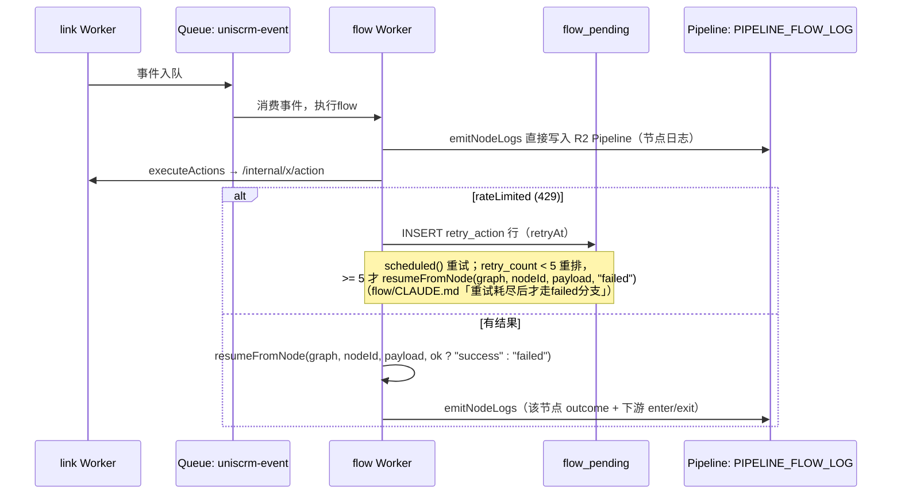
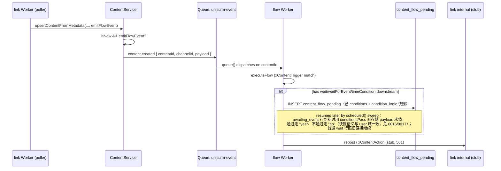
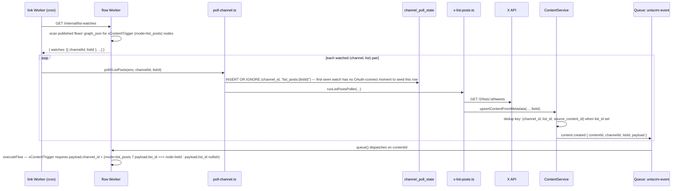
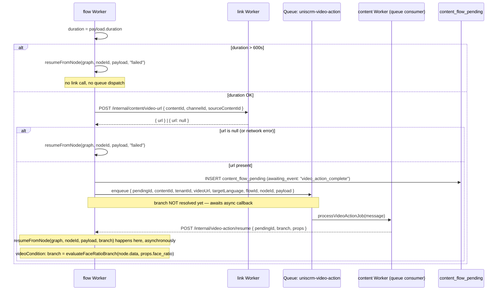

`FLOW_LOG_QUEUE`/`handleLogQueue`（批量写入租户 D1 `flow_log` 表）已移除 —
`emitNodeLogs` 现在只调用 `env.PIPELINE_FLOW_LOG.send(...)`，不再有中间队列/D1落地这一跳。

user 域的 action 分支解析与 content 域一致：`executeActions` 拿到 `graph` 后自己调
`resumeFromNode` 继续走 success/failed 边（此前只记 outcome 日志、下游节点永不执行）。
`abSplit`/`userPropsCondition` 仍未接线 —— 它们在 `executeActions` 里根本没有执行分支。

## Content-triggered flows



`content_flow_executions`（连同 `flow_executions`）已移除 — 触发次数改由
`recomputeFlowCounts()` 从 R2 日志聚合，缓存到 `flows.trigger_count`。

分支解析的收尾（resumeFromNode → 节点日志 → 递归执行下游 action → 落 pending wait）在
user / content 两域统一收敛到 `recordBranchOutcome`（src/index.ts）：user 域的
`executeActions.recordOutcome`、content 域 `executeContentActions` 的全部分支点、
`scheduled()` 的 content sweep 三个解析点、以及 `POST /internal/video-action/resume`
都经由它落库，pending 行从此总是带 conditions + condition_logic 快照。content 域没有
事件驱动的 wait 解析（content.created 每次都是新的 content_id），sweep 到期即是
waitForEvent 条件快照的唯一求值点；video_action_complete 行的 conditions 恒为空，
其解析结果由 videoAction/videoCondition 的 outcome 本身决定，不套 conditionsPass 门禁。

## Content-domain: xContentAction (real generation + publish)

The `xContentAction` call above is no longer a 501 stub. This diagram replaces
that leg with the real path: `flow` interpolates `$content.xxx` into the node's
prompt itself, then calls `link`'s `create-post` handler, which (unless
`provider` is `"none"`) calls `content` to generate the final text, then posts
it to X, then `flow` resolves the graph's success/failed branch — including
the rate-limit retry loop via `content_flow_pending`. `link` no longer queries
the source `content` row itself — `flow` already resolved the final prompt
text before this call.

```mermaid
sequenceDiagram
    participant FW as flow Worker
    participant LW as link Worker
    participant CW as content Worker
    participant XAPI as X API
    participant TDB as Tenant D1
    participant CFP as content_flow_pending

    FW->>FW: interpolate $content.xxx into node's prompt -> interpolatedPrompt
    Note over FW: when the node's "Attach AI-generated image" checkbox is on (non-video<br/>call site only), FW also reads the triggering content's title/text verbatim and<br/>merges { sourceTitle, sourceText, imageProvider } into the same request body below —<br/>no image prompt is built or interpolated in flow
    FW->>LW: POST /internal/content/create-post { contentId, interpolatedPrompt, provider, targetChannelId, flowId, sourceTitle?, sourceText?, imageProvider? }
    alt provider !== "none"
        LW->>CW: POST /internal/generate { tenantId, prompt: interpolatedPrompt, provider }
        CW-->>LW: { text }
    else provider === "none"
        Note over LW: skip content entirely, text = interpolatedPrompt verbatim
    end
    opt sourceTitle or sourceText present (and no video media id was produced)
        LW->>CW: POST /internal/generate-image { tenantId, sourceTitle, sourceText, provider: imageProvider }
        CW->>CW: stage 1 (text model): distill sourceTitle/sourceText into a short visual description
        CW->>CW: stage 2 (diffusion model): render that description into an image
        CW-->>LW: { url }  (R2 public media)
        LW->>XAPI: media/upload initialize+append+finalize (media_category="tweet_image")
        XAPI-->>LW: media_id
    end
    alt targetChannel.channel_type === "X"
        LW->>XAPI: POST /2/tweets
        XAPI-->>LW: { id } | 429 rate limited | error
    else other channel_type (e.g. TikTok)
        Note over LW: out of scope this phase, returns { ok:false }
    end
    opt posted successfully
        LW->>TDB: recordPublishedContent(targetChannelId, "X", postId, text, ...)
    end
    LW-->>FW: { ok:true } | { ok:false } | { ok:false, rateLimited:true, rateLimitReset }
    alt rateLimited
        FW->>CFP: INSERT content_flow_pending (retry_action, retry_count: 0)
        Note over FW,CFP: scheduled() sweep retries at rateLimitReset;<br/>retry_count < 5 reschedules;<br/>retry_count >= 5 resolves resumeFromNode(graph, nodeId, payload, "failed") before deleting the row<br/>(per flow/CLAUDE.md's "重试耗尽后才走failed分支" rule)
    else resolved (ok or non-rate-limited failure)
        FW->>FW: resumeFromNode(graph, nodeId, payload, ok ? "success" : "failed")
    end
```

The image path never enters the video branch's `pending: true` / poll-and-reschedule machinery
(`content_flow_pending`'s `xVideoStatusPoll` retry_action): X performs no asynchronous
transcoding for images, so `finalize` never returns `processing_info` and there is nothing to
poll. If image generation, the image download, or the X media upload fails — including a thrown
network error (fetch/json() rejecting), not just a non-2xx HTTP response — it is logged as
`create_post_image_failed` (with a `stage` field distinguishing `generate` from `upload`) and the
node still posts the text-only tweet and still records success; the image is best-effort only.

Image generation inside `content` is two-stage, both stages scoped to the same
`/internal/generate-image` call: stage 1 is a text model that turns `sourceTitle`/`sourceText`
into a short plain-text visual description; stage 2 is the diffusion model that renders that
description. Stage 1's system prompt is composed of the `marketingskills-image` skill's content
plus the calling tenant's marketing context (`skill_context` row for that skill's repo, when one
exists) — the same skill+context injection every other `generate`/`generate-image` call goes
through, not something special-cased for images. Stage 1 itself puts no upper bound on
`sourceText`'s length before it reaches the text model; prompt-length protection (clamping to a
provider's max prompt size) lives in the image provider adapters (`clampPrompt`), applied to
stage 2's diffusion prompt, not in stage 1.

## X List Posts trigger: demand-sync + per-list dedup

`link`'s cron has no direct visibility into `flow`'s `graph_json` (separate DB) — it pulls
current demand from `flow` before each polling cycle, rather than `flow` pushing state into
`link` on publish/unpublish.



Same tweet appearing in two different monitored Lists produces two separate `content` rows
(one per list) and fires both lists' flows independently — this is intentional (see the
design spec's "Cross-list dedup" decision), not a duplicate-trigger bug. `list_id` does not
join the R2 analytics pipeline in this phase (see the design spec's Global Constraints) —
analytics collapses both rows to one via the existing `(tenant_id, channel_id,
source_content_id)` compactor key.

## Content-domain: videoAction / videoCondition (dispatch to the dedicated video-action queue)

Architecturally different from every other branch in `executeContentActions`: the
success path does **not** call `resumeFromNode` synchronously — branch resolution
happens later, when `content`'s queue consumer finishes the job and calls back into
`POST /internal/video-action/resume`. Only the two early-exit guards below (duration
cap, no video found) resolve the "failed" branch synchronously here. The full
pipeline inside `content`'s consumer is diagrammed separately in
`content/src/services/video-action/sequence.md`.

`videoCondition` shares this entire path — same video resolution, same duration cap,
same pending row, same queue — dispatching `operation: "check-face"`. It differs only
at the callback: `content` returns a measured `face_ratio` and the resume route
compares it against the node's own `operator`/`threshold` to pick `true`/`false`.
That comparison lives here, in the graph, never in `content`.


